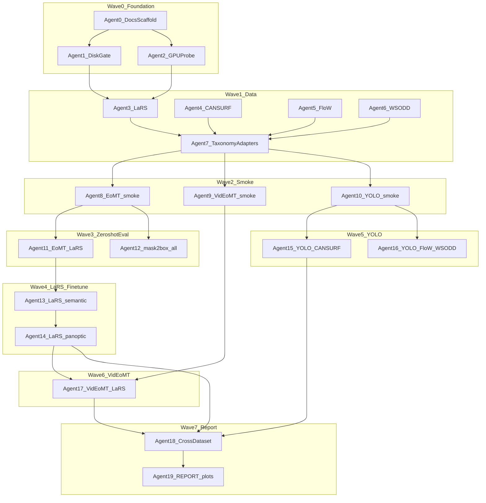

# Water debris segmentation — agent swarm

**Status:** Wave 1 — LaRS + CANSURF on scratch; Wave 2 smoke done. FloW pending ORCA. **WSODD out of scope v1** (ablation 06 cancelled).  
**Host:** Snellius — data on `/scratch-shared/$USER/water-debris-seg/`, repo on home ([`DISK_BUDGET.md`](../data/water_debris/DISK_BUDGET.md)).  
**Spec:** [`water_debris_seg_benchmark.md`](water_debris_seg_benchmark.md)  
**Decision log:** [`water_debris_seg_decision_log.md`](water_debris_seg_decision_log.md)  
**Artifacts:** [`eval_outputs/water_debris_seg/`](../eval_outputs/water_debris_seg/) (repo root)

**Research question:** Can general-purpose mask transformers (EoMT, VidEoMT) match or beat specialized detectors on nearshore debris, and does temporal modeling help on USV video?

---

## Gate rule

No dataset downloads, clones, or GPU jobs until:

1. [`data/water_debris/DISK_BUDGET.md`](../data/water_debris/DISK_BUDGET.md) shows free space ≥ next stage + 20% slack on the **intended tier** (datasets → scratch-shared; repo/manifests → home).
2. [`eval_outputs/water_debris_seg/GPU_INVENTORY.md`](../eval_outputs/water_debris_seg/GPU_INVENTORY.md) lists ≥1 working CUDA device from an **`srun`/`sbatch` GPU job** (not the login node).
3. Ablation README stubs exist under `eval_outputs/water_debris_seg/ablations/`.

**Snellius storage rule:** scratch is **not permanent** (14-day inactivity purge on `/scratch-shared`). Copy manifests, metrics, and final checkpoints to home; never keep the only copy of data on scratch.

---

## Agent swarm



---

## Timeline

| Stage | Days | Owner wave | Gate to next |
|---|---|---|---|
| **0** Foundation | 0.5 | Wave 0 | Spec + stubs; disk + GPU docs |
| **1** Data + adapters | 1–3 | Wave 1 | File manifest; skip blocked sets honestly |
| **2** Smoke | 0.5–1 | Wave 2 | Overlays + 1 metric row per stack |
| **3** Zero-shot eval | 1–2 | Wave 3 | Ablations 01, 04–06 (no `fit` on box sets) |
| **4** LaRS fine-tune | 2–4 | Wave 4 | Ablations 02–03; last ckpt only |
| **5** YOLO specialized | 1–2 | Wave 5 | Ablation 08 |
| **6** VidEoMT | 2–3 | Wave 6 | Ablation 07; LaRS sequences on disk |
| **7** Report | 1 | Wave 7 | `REPORT.md`, `metrics.json`, plots |

**~10–16 working days** with LaRS + CANSURF on day 1.

---

## Agent prompts (copy-paste)

### Agent 0 — Docs scaffold

```
Owns: docs/water_debris_seg_*.md, eval_outputs/water_debris_seg/ tree
Tasks: benchmark spec, swarm doc, ablation README stubs, REPORT catalog
Depends: nothing
Checklist:
  [ ] Hard rule visible at top of benchmark.md
  [ ] Each ablation has Question + expected outcome
  [ ] decision log baseline entry
```

### Agent 1 — Disk gate

```
Owns: data/water_debris/DISK_BUDGET.md
Tasks: df -h + quota -s before each stage; map home vs scratch-shared; compare to plan table + 20% slack
Depends: Agent 0
Checklist:
  [ ] Current avail bytes recorded (home + scratch)
  [ ] scratch-shared user tree created if Stage ≥1
  [ ] Next stage GO/NO-GO with reason
```

### Agent 2 — GPU probe

```
Owns: eval_outputs/water_debris_seg/GPU_INVENTORY.md
Tasks: srun on gpu_a100/gpu_h100; nvidia-smi -L; per-device torch alloc in benchmark conda env
Depends: Agent 0
Checklist:
  [ ] working_devices[] listed (hostname + GPU name)
  [ ] failed_devices[] with error text
  [ ] Slurm partition + --gres documented in GPU_INVENTORY.md
```

### Agent 3 — LaRS download

```
Owns: data/water_debris/lars/
Tasks: form download images + annotations; optional sequences later
Depends: Agents 1, 2 (GO on disk)
Checklist:
  [ ] panoptic_annotations.json + masks present
  [ ] manifest sha256 in sources/
```

### Agent 4 — CANSURF

```
Owns: data/water_debris/cansurf/
Tasks: clone/GitHub or Zenodo raw train/val only (no 57k aug expansion)
Depends: Disk gate
```

### Agent 5 — FloW

```
Owns: data/water_debris/flow/
Tasks: ORCA application download FloW-Img; log if blocked
Depends: Disk gate
```

### Agent 6 — WSODD *(cancelled v1)*

Ablation 06 out of scope (Baidu Pan). No download tasks.

### Agent 7 — Taxonomy adapters

```
Owns: water-debris-seg/datasets/ (future) or third_party adapters
Tasks: unified class map; LaRS→COCO panoptic for EoMT; boxes→COCO for mAP eval
Depends: Agents 3–6 (partial OK)
Tests: import smoke + 1 batch load per available dataset
```

### Agent 8 — EoMT smoke

```
Owns: third_party/eomt/, eval_outputs/.../smoke/eomt/
Tasks: conda env; 8–16 LaRS or COCO val images; overlay PNGs
Depends: Agent 7 (or COCO-only fallback)
Hard rule: no fit on FloW/CANSURF
```

### Agent 9 — VidEoMT smoke

```
Owns: third_party/videomt/, smoke/videomt/
Tasks: detectron2 install; eval-only 1 clip if LaRS sequences exist
Depends: Agent 8 optional parallel
```

### Agent 10 — YOLO smoke

```
Owns: smoke/yolo/
Tasks: ultralytics; 1-epoch micro-train on CANSURF subset OR dry-run predict
Depends: Agent 4
```

### Agent 11 — EoMT zero-shot LaRS

```
Owns: ablations/01_zeroshot_lars/
Tasks: COCO/ADE ckpt validate on LaRS val; PQ/mIoU table
Depends: Agent 8
```

### Agent 12 — mask→box eval

```
Owns: ablations/04_flow_mask2box, 05_cansurf_small_object, 06_wsodd_distractors
Tasks: shared script masks_to_coco_boxes.py + pycocotools eval; eval-only weights
Depends: Agents 8, 7
Hard rule: NO training on these datasets
Parallel: 1 GPU per dataset job
```

### Agent 13–14 — LaRS fine-tune

```
Owns: ablations/02_finetune_lars_semantic, 03_finetune_lars_panoptic
Tasks: eomt main.py fit; load_ckpt_class_head False; DDP batch 16
Depends: Agent 11
Hard rule: LaRS ONLY
```

### Agent 15–16 — YOLO trains

```
Owns: ablation/08_specialized_yolo/
Tasks: YOLOv11 on CANSURF; optional FloW
Depends: Agent 10
```

### Agent 17 — VidEoMT LaRS

```
Owns: ablation/07_videomt_temporal/
Tasks: download LaRS sequences; train or eval-only; compare to EoMT still
Depends: Agents 13–14, LaRS sequences on disk
```

### Agent 18–19 — Report

```
Owns: REPORT.md, metrics.json, plots/
Tasks: cross-dataset table; copy sources/; experiment catalog
Depends: all completed ablations
Checklist:
  [ ] Missing datasets marked "not run" in README + decision log
  [ ] No invented metrics
```

---

## Parallelism and Slurm (Snellius)

- **Partition:** `gpu_a100` (default) or `gpu_h100`; **Eval:** `#SBATCH --gres=gpu:1` per (model × dataset); array jobs OK.
- **EoMT fit:** `#SBATCH --partition=gpu_a100 --gres=gpu:4` on one node (4× A100 40GB); if queue constrained, use `--gres=gpu:1` with gradient accumulation to effective batch 16.
- **I/O:** read/write datasets under `/scratch-shared/$USER/water-debris-seg/`; `#SBATCH --constraint=scratch-node` + `$TMPDIR` only for per-job burst I/O.
- **Avoid** drained/down nodes: inspect `sinfo -p gpu_a100` before large array submits.
- Prefer Slurm `--gres` over manual `CUDA_VISIBLE_DEVICES`.

---

## Logging

| File | Purpose |
|---|---|
| `data/water_debris/DISK_BUDGET.md` | Per-stage disk gates |
| `eval_outputs/water_debris_seg/GPU_INVENTORY.md` | Device probe |
| `docs/water_debris_seg_decision_log.md` | Human-readable decisions |
| `eval_outputs/water_debris_seg/ablations/*/sources/jobids.json` | Slurm IDs (when used) |

---

## Definition of done (benchmark)

- Headline table in `REPORT.md`: EoMT / VidEoMT / YOLO × LaRS + available box sets.
- Every number has a **Source** path in its ablation README.
- Hard rule satisfied: no EoMT/VidEoMT checkpoint trained on FloW/CANSURF.
