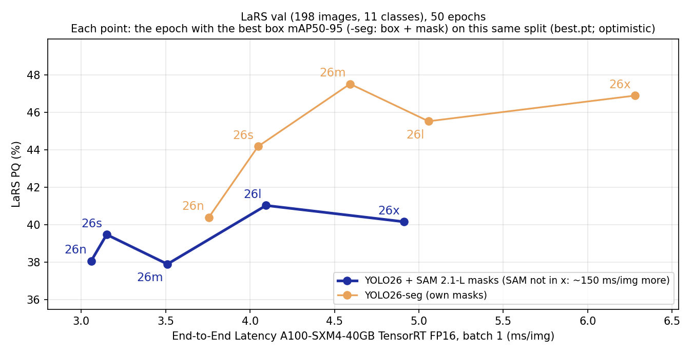
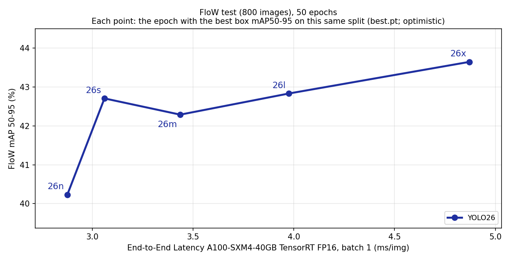
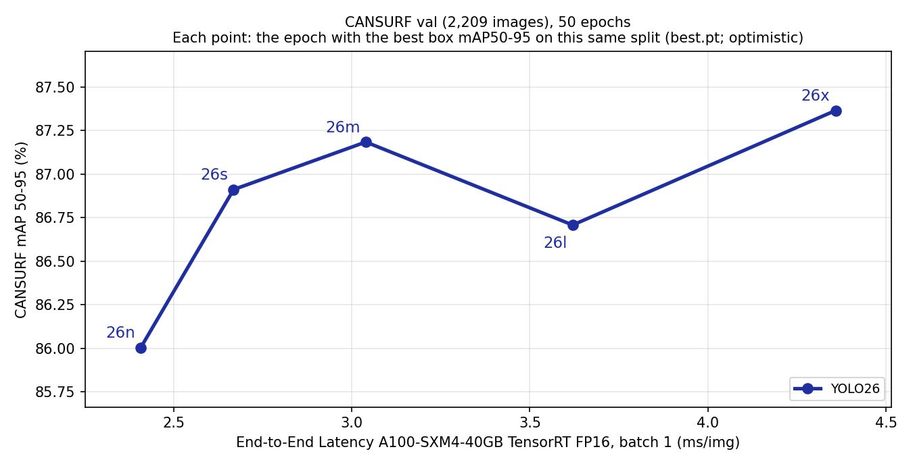

# Benchmark tables

Generated by `water-debris-seg/scripts/make_latex_tables.py` together with the LaTeX version ([latex/benchmark_tables.tex](latex/benchmark_tables.tex)); do not edit by hand.

**Auditing.** Every value of ours links to the JSON it was read from; published values link to their paper. **Code** links to the ablation / fix table below, which links to that page. **W&B**: B = the scored stage-B training run (held-out protocol), A = its stage-A run (epoch-count selection), train = the ablation 11 training run (its best.pt is scored), ab03 = the ablation 03 run whose segments the EoMT + SAM control uses. Values are % (fractions × 100).

## 1. Benchmark results

### LaRS

| Source | Model | Code | Params (M) | PQ ([L11](#cls-l11)) | PQTh | PQSt | mIoU ([L3](#cls-l3)) | Box AP ([L9](#cls-l9)) | W&B |
|---|---|---|---:|---:|---:|---:|---:|---:|---|
| [LaRS paper](https://arxiv.org/abs/2308.09618)‡ | Panoptic DeepLab (ResNet-50) |  | -- | [34.7](https://arxiv.org/abs/2308.09618) | [13.4](https://arxiv.org/abs/2308.09618) | [91.4](https://arxiv.org/abs/2308.09618) | [95.4](https://arxiv.org/abs/2308.09618) | -- | paper |
| [LaRS paper](https://arxiv.org/abs/2308.09618)‡ | Panoptic FPN (ResNet-50) |  | -- | [40.1](https://arxiv.org/abs/2308.09618) | [21.7](https://arxiv.org/abs/2308.09618) | [89.3](https://arxiv.org/abs/2308.09618) | [93.5](https://arxiv.org/abs/2308.09618) | -- | paper |
| [LaRS paper](https://arxiv.org/abs/2308.09618)‡ | Panoptic FPN (ResNet-101) |  | -- | [38.7](https://arxiv.org/abs/2308.09618) | [19.7](https://arxiv.org/abs/2308.09618) | [89.4](https://arxiv.org/abs/2308.09618) | [93.3](https://arxiv.org/abs/2308.09618) | -- | paper |
| [LaRS paper](https://arxiv.org/abs/2308.09618)‡ | MaX-DeepLab (MaX-S) |  | -- | [31.9](https://arxiv.org/abs/2308.09618) | [9.5](https://arxiv.org/abs/2308.09618) | [91.7](https://arxiv.org/abs/2308.09618) | [95.4](https://arxiv.org/abs/2308.09618) | -- | paper |
| [LaRS paper](https://arxiv.org/abs/2308.09618)‡ | Mask2Former (ResNet-50) |  | -- | [37.6](https://arxiv.org/abs/2308.09618) | [17.0](https://arxiv.org/abs/2308.09618) | [92.4](https://arxiv.org/abs/2308.09618) | [95.4](https://arxiv.org/abs/2308.09618) | -- | paper |
| [LaRS paper](https://arxiv.org/abs/2308.09618)‡ | Mask2Former (ResNet-101) |  | -- | [37.2](https://arxiv.org/abs/2308.09618) | [16.3](https://arxiv.org/abs/2308.09618) | [92.8](https://arxiv.org/abs/2308.09618) | [95.6](https://arxiv.org/abs/2308.09618) | -- | paper |
| [LaRS paper](https://arxiv.org/abs/2308.09618)‡ | Mask2Former (Swin-T) |  | -- | [39.2](https://arxiv.org/abs/2308.09618) | [18.8](https://arxiv.org/abs/2308.09618) | [93.7](https://arxiv.org/abs/2308.09618) | [96.8](https://arxiv.org/abs/2308.09618) | -- | paper |
| [LaRS paper](https://arxiv.org/abs/2308.09618)‡ | Mask2Former (Swin-B) |  | -- | [41.7](https://arxiv.org/abs/2308.09618) | [21.8](https://arxiv.org/abs/2308.09618) | [94.7](https://arxiv.org/abs/2308.09618) | [97.6](https://arxiv.org/abs/2308.09618) | -- | paper |
| Ours | EoMT zero-shot | [F1](#abl-f1) | 93.6 | [30.3](fairness_fixes/sources/lars_official_eomt_zeroshot_tightened_28617624.json) | [7.9](fairness_fixes/sources/lars_official_eomt_zeroshot_tightened_28617624.json) | [89.9](fairness_fixes/sources/lars_official_eomt_zeroshot_tightened_28617624.json) | [96.4](fairness_fixes/sources/lars_official_eomt_zeroshot_tightened_28617624.json) | [7.0](fairness_fixes/sources/fix1_coco133_lars_map-tightened_28511590.json) | no training (COCO weights) |
| Ours | EoMT, full fine-tuning | [F4](#abl-f4) | 93.6 | [40.4](fairness_fixes/sources/lars_official_eomt_full_28617625.json) | [20.3](fairness_fixes/sources/lars_official_eomt_full_28617625.json) | [94.2](fairness_fixes/sources/lars_official_eomt_full_28617625.json) | [97.5](fairness_fixes/sources/lars_official_eomt_full_28617625.json) | [17.1](fairness_fixes/sources/fix1_lars_panoptic_lars_eomt_full_28511607.json) | [B](https://wandb.ai/riccardo-campanella/water-debris-seg/runs/yphvg0cr) · [A](https://wandb.ai/riccardo-campanella/water-debris-seg/runs/zxokqelg) |
| Ours | EoMT, LoRA | [F4](#abl-f4) | 93.6 + 2.4 | [38.0](fairness_fixes/sources/lars_official_eomt_lora_28617626.json) | [17.1](fairness_fixes/sources/lars_official_eomt_lora_28617626.json) | [93.8](fairness_fixes/sources/lars_official_eomt_lora_28617626.json) | [97.4](fairness_fixes/sources/lars_official_eomt_lora_28617626.json) | [16.8](fairness_fixes/sources/fix1_lars_panoptic_lars_eomt_lora_28511609.json) | [B](https://wandb.ai/riccardo-campanella/water-debris-seg/runs/8xdisbps) · [A](https://wandb.ai/riccardo-campanella/water-debris-seg/runs/7wrw1rkt) |
| Ours | EoMT + SAM 2.1-L (control) | [F1](#abl-f1) | 93.6 + 224.5 | [34.2](fairness_fixes/sources/lars_official_eomt_ab03_sam_28617629.json) | [21.4](fairness_fixes/sources/lars_official_eomt_ab03_sam_28617629.json) | [68.5](fairness_fixes/sources/lars_official_eomt_ab03_sam_28617629.json) | [76.1](fairness_fixes/sources/lars_official_eomt_ab03_sam_28617629.json) | -- | [ab03](https://wandb.ai/riccardo-campanella/water-debris-seg/runs/67kk33hk) |
| Ours | YOLOv11s + SAM 2.1-L | [F2](#abl-f2) | 9.5 + 224.5 | [35.0](fairness_fixes/sources/lars_official_yolo11s_sam_t020_28617630.json) | [23.9](fairness_fixes/sources/lars_official_yolo11s_sam_t020_28617630.json) | [64.5](fairness_fixes/sources/lars_official_yolo11s_sam_t020_28617630.json) | [74.4](fairness_fixes/sources/lars_official_yolo11s_sam_t020_28617630.json) | [19.6](ablations/10_yolo_lars_boxes/sources/eval_lars_full_11s_11cls_stageB_28515717.json) | [B](https://wandb.ai/riccardo-campanella/water-debris-seg/runs/lars_full_11s_11cls_stageB_20261023_210948) · [A](https://wandb.ai/riccardo-campanella/water-debris-seg/runs/lars_full_11s_11cls_stageA_20261023_205324) |
| Ours | YOLOv11s | [A10](#abl-a10) | 9.5 | -- | -- | -- | -- | [19.5](ablations/10_yolo_lars_boxes/sources/eval_lars_full_11s_stageB_28378811.json) | [B](https://wandb.ai/riccardo-campanella/water-debris-seg/runs/lars_full_11s_stageB_20261020_170700) · [A](https://wandb.ai/riccardo-campanella/water-debris-seg/runs/lars_full_11s_stageA_20261020_161452) |
| Ours (A11)† | YOLO26n + SAM 2.1-L | [A11](#abl-a11) | 2.5 + 224.5 | [38.2](ablations/11_yolo26_family/sources/lars_official_ab11_lars11_yolo26n_28826539.json) | [29.2](ablations/11_yolo26_family/sources/lars_official_ab11_lars11_yolo26n_28826539.json) | [62.3](ablations/11_yolo26_family/sources/lars_official_ab11_lars11_yolo26n_28826539.json) | [71.4](ablations/11_yolo26_family/sources/lars_official_ab11_lars11_yolo26n_28826539.json) | -- | [train](https://wandb.ai/riccardo-campanella/water-debris-seg/runs/lars11_yolo26n_20261102_120019) |
| Ours (A11)† | YOLO26s + SAM 2.1-L | [A11](#abl-a11) | 10.0 + 224.5 | [39.8](ablations/11_yolo26_family/sources/lars_official_ab11_lars11_yolo26s_28826550.json) | [29.6](ablations/11_yolo26_family/sources/lars_official_ab11_lars11_yolo26s_28826550.json) | [67.3](ablations/11_yolo26_family/sources/lars_official_ab11_lars11_yolo26s_28826550.json) | [77.2](ablations/11_yolo26_family/sources/lars_official_ab11_lars11_yolo26s_28826550.json) | -- | [train](https://wandb.ai/riccardo-campanella/water-debris-seg/runs/lars11_yolo26s_20261102_120033) |
| Ours (A11)† | YOLO26m + SAM 2.1-L | [A11](#abl-a11) | 21.8 + 224.5 | [38.2](ablations/11_yolo26_family/sources/lars_official_ab11_lars11_yolo26m_28826553.json) | [28.2](ablations/11_yolo26_family/sources/lars_official_ab11_lars11_yolo26m_28826553.json) | [65.0](ablations/11_yolo26_family/sources/lars_official_ab11_lars11_yolo26m_28826553.json) | [73.1](ablations/11_yolo26_family/sources/lars_official_ab11_lars11_yolo26m_28826553.json) | -- | [train](https://wandb.ai/riccardo-campanella/water-debris-seg/runs/lars11_yolo26m_20261102_120106) |
| Ours (A11)† | YOLO26l + SAM 2.1-L | [A11](#abl-a11) | 26.2 + 224.5 | [41.4](ablations/11_yolo26_family/sources/lars_official_ab11_lars11_yolo26l_28826557.json) | [32.0](ablations/11_yolo26_family/sources/lars_official_ab11_lars11_yolo26l_28826557.json) | [66.5](ablations/11_yolo26_family/sources/lars_official_ab11_lars11_yolo26l_28826557.json) | [76.1](ablations/11_yolo26_family/sources/lars_official_ab11_lars11_yolo26l_28826557.json) | -- | [train](https://wandb.ai/riccardo-campanella/water-debris-seg/runs/lars11_yolo26l_20261102_120102) |
| Ours (A11)† | YOLO26x + SAM 2.1-L | [A11](#abl-a11) | 58.8 + 224.5 | [40.8](ablations/11_yolo26_family/sources/lars_official_ab11_lars11_yolo26x_28826560.json) | [31.5](ablations/11_yolo26_family/sources/lars_official_ab11_lars11_yolo26x_28826560.json) | [65.8](ablations/11_yolo26_family/sources/lars_official_ab11_lars11_yolo26x_28826560.json) | [75.4](ablations/11_yolo26_family/sources/lars_official_ab11_lars11_yolo26x_28826560.json) | -- | [train](https://wandb.ai/riccardo-campanella/water-debris-seg/runs/lars11_yolo26x_20261102_120118) |
| Ours (A11)† | YOLO26n-seg | [A11](#abl-a11) | 3.1 | [40.6](ablations/11_yolo26_family/sources/lars_official_ab11_lars11_yolo26n-seg_28826541.json) | [21.7](ablations/11_yolo26_family/sources/lars_official_ab11_lars11_yolo26n-seg_28826541.json) | [91.0](ablations/11_yolo26_family/sources/lars_official_ab11_lars11_yolo26n-seg_28826541.json) | [94.6](ablations/11_yolo26_family/sources/lars_official_ab11_lars11_yolo26n-seg_28826541.json) | -- | [train](https://wandb.ai/riccardo-campanella/water-debris-seg/runs/lars11_yolo26n-seg_20261102_120020) |
| Ours (A11)† | YOLO26s-seg | [A11](#abl-a11) | 11.4 | [44.5](ablations/11_yolo26_family/sources/lars_official_ab11_lars11_yolo26s-seg_28826552.json) | [27.0](ablations/11_yolo26_family/sources/lars_official_ab11_lars11_yolo26s-seg_28826552.json) | [91.3](ablations/11_yolo26_family/sources/lars_official_ab11_lars11_yolo26s-seg_28826552.json) | [95.1](ablations/11_yolo26_family/sources/lars_official_ab11_lars11_yolo26s-seg_28826552.json) | -- | [train](https://wandb.ai/riccardo-campanella/water-debris-seg/runs/lars11_yolo26s-seg_20261102_120040) |
| Ours (A11)† | YOLO26m-seg | [A11](#abl-a11) | 27.0 | [47.7](ablations/11_yolo26_family/sources/lars_official_ab11_lars11_yolo26m-seg_28826555.json) | [31.2](ablations/11_yolo26_family/sources/lars_official_ab11_lars11_yolo26m-seg_28826555.json) | [92.0](ablations/11_yolo26_family/sources/lars_official_ab11_lars11_yolo26m-seg_28826555.json) | [95.3](ablations/11_yolo26_family/sources/lars_official_ab11_lars11_yolo26m-seg_28826555.json) | -- | [train](https://wandb.ai/riccardo-campanella/water-debris-seg/runs/lars11_yolo26m-seg_20261102_120142) |
| Ours (A11)† | YOLO26l-seg | [A11](#abl-a11) | 31.4 | [45.8](ablations/11_yolo26_family/sources/lars_official_ab11_lars11_yolo26l-seg_28826559.json) | [28.3](ablations/11_yolo26_family/sources/lars_official_ab11_lars11_yolo26l-seg_28826559.json) | [92.5](ablations/11_yolo26_family/sources/lars_official_ab11_lars11_yolo26l-seg_28826559.json) | [95.8](ablations/11_yolo26_family/sources/lars_official_ab11_lars11_yolo26l-seg_28826559.json) | -- | [train](https://wandb.ai/riccardo-campanella/water-debris-seg/runs/lars11_yolo26l-seg_20261102_120109) |
| Ours (A11)† | YOLO26x-seg | [A11](#abl-a11) | 70.5 | [47.1](ablations/11_yolo26_family/sources/lars_official_ab11_lars11_yolo26x-seg_28826562.json) | [30.2](ablations/11_yolo26_family/sources/lars_official_ab11_lars11_yolo26x-seg_28826562.json) | [92.2](ablations/11_yolo26_family/sources/lars_official_ab11_lars11_yolo26x-seg_28826562.json) | [96.0](ablations/11_yolo26_family/sources/lars_official_ab11_lars11_yolo26x-seg_28826562.json) | -- | [train](https://wandb.ai/riccardo-campanella/water-debris-seg/runs/lars11_yolo26x-seg_20261102_120117) |

LaRS. PQ, PQ_Th / PQ_St (things / stuff) and mIoU: official LaRS evaluator; ours on LaRS val (198 images, YOLO26 at confidence 0.20). ‡Published baselines from the LaRS paper (Table 4: PQ; Table 5: mIoU under the semantic setup) on the LaRS test set via the evaluation server: a different split from ours, so the comparison is indicative. Box AP: pycocotools mAP@[.50:.95] on boxes traced from the val masks. Params: + SAM 2.1-L where its masks are scored, + LoRA adapters. †A11: checkpoint picked on the evaluation split (optimistic); other rows of ours use held-out epoch selection. --: not reported or not applicable.

### FloW

| Source | Model | Code | Params (M) | Box AP ([waste](#cls-waste)) | W&B |
|---|---|---|---:|---:|---|
| [FloW paper](https://openaccess.thecvf.com/content/ICCV2021/papers/Cheng_FloW_A_Dataset_and_Benchmark_for_Floating_Waste_Detection_in_ICCV_2021_paper.pdf) | DSSD |  | -- | [27.5](https://openaccess.thecvf.com/content/ICCV2021/papers/Cheng_FloW_A_Dataset_and_Benchmark_for_Floating_Waste_Detection_in_ICCV_2021_paper.pdf) | paper |
| [FloW paper](https://openaccess.thecvf.com/content/ICCV2021/papers/Cheng_FloW_A_Dataset_and_Benchmark_for_Floating_Waste_Detection_in_ICCV_2021_paper.pdf) | RetinaNet |  | -- | [24.9](https://openaccess.thecvf.com/content/ICCV2021/papers/Cheng_FloW_A_Dataset_and_Benchmark_for_Floating_Waste_Detection_in_ICCV_2021_paper.pdf) | paper |
| [FloW paper](https://openaccess.thecvf.com/content/ICCV2021/papers/Cheng_FloW_A_Dataset_and_Benchmark_for_Floating_Waste_Detection_in_ICCV_2021_paper.pdf) | YOLOv3 |  | -- | [12.8](https://openaccess.thecvf.com/content/ICCV2021/papers/Cheng_FloW_A_Dataset_and_Benchmark_for_Floating_Waste_Detection_in_ICCV_2021_paper.pdf) | paper |
| [FloW paper](https://openaccess.thecvf.com/content/ICCV2021/papers/Cheng_FloW_A_Dataset_and_Benchmark_for_Floating_Waste_Detection_in_ICCV_2021_paper.pdf) | Faster R-CNN |  | -- | [18.4](https://openaccess.thecvf.com/content/ICCV2021/papers/Cheng_FloW_A_Dataset_and_Benchmark_for_Floating_Waste_Detection_in_ICCV_2021_paper.pdf) | paper |
| [FloW paper](https://openaccess.thecvf.com/content/ICCV2021/papers/Cheng_FloW_A_Dataset_and_Benchmark_for_Floating_Waste_Detection_in_ICCV_2021_paper.pdf) | FPN |  | -- | [33.4](https://openaccess.thecvf.com/content/ICCV2021/papers/Cheng_FloW_A_Dataset_and_Benchmark_for_Floating_Waste_Detection_in_ICCV_2021_paper.pdf) | paper |
| [FloW paper](https://openaccess.thecvf.com/content/ICCV2021/papers/Cheng_FloW_A_Dataset_and_Benchmark_for_Floating_Waste_Detection_in_ICCV_2021_paper.pdf) | Cascade R-CNN |  | -- | [43.4](https://openaccess.thecvf.com/content/ICCV2021/papers/Cheng_FloW_A_Dataset_and_Benchmark_for_Floating_Waste_Detection_in_ICCV_2021_paper.pdf) | paper |
| Ours | EoMT (SAM masks), full fine-tuning | [F3](#abl-f3) | 93.6 | [23.6](fairness_fixes/sources/fix1_box_instance_flow_eomt_full_28547302.json) | [B](https://wandb.ai/riccardo-campanella/water-debris-seg/runs/whcbnw3e) · [A](https://wandb.ai/riccardo-campanella/water-debris-seg/runs/tdxrxg6w) |
| Ours | EoMT (SAM masks), LoRA | [F4](#abl-f4) | 93.6 + 2.4 | [22.0](fairness_fixes/sources/fix1_box_instance_flow_eomt_lora_28547305.json) | [B](https://wandb.ai/riccardo-campanella/water-debris-seg/runs/eg9pabqv) · [A](https://wandb.ai/riccardo-campanella/water-debris-seg/runs/5oz1099z) |
| Ours | YOLOv11s | [F3](#abl-f3) | 9.5 | [40.1](fairness_fixes/sources/eval_flow_full_11s_stageB_28511601.json) | [B](https://wandb.ai/riccardo-campanella/water-debris-seg/runs/flow_full_11s_stageB_20261023_195008) · [A](https://wandb.ai/riccardo-campanella/water-debris-seg/runs/flow_full_11s_stageA_20261023_194420) |
| Ours (A11)† | YOLO26n | [A11](#abl-a11) | 2.5 | [40.2](ablations/11_yolo26_family/sources/coco_eval_flow_yolo26n_28771673.json) | [train](https://wandb.ai/riccardo-campanella/water-debris-seg/runs/flow_yolo26n_20261030_123557) |
| Ours (A11)† | YOLO26s | [A11](#abl-a11) | 9.9 | [42.7](ablations/11_yolo26_family/sources/coco_eval_flow_yolo26s_28771677.json) | [train](https://wandb.ai/riccardo-campanella/water-debris-seg/runs/flow_yolo26s_20261030_124059) |
| Ours (A11)† | YOLO26m | [A11](#abl-a11) | 21.8 | [42.3](ablations/11_yolo26_family/sources/coco_eval_flow_yolo26m_28771682.json) | [train](https://wandb.ai/riccardo-campanella/water-debris-seg/runs/flow_yolo26m_20261030_125502) |
| Ours (A11)† | YOLO26l | [A11](#abl-a11) | 26.2 | [42.8](ablations/11_yolo26_family/sources/coco_eval_flow_yolo26l_28771686.json) | [train](https://wandb.ai/riccardo-campanella/water-debris-seg/runs/flow_yolo26l_20261030_125846) |
| Ours (A11)† | YOLO26x | [A11](#abl-a11) | 58.8 | [43.6](ablations/11_yolo26_family/sources/coco_eval_flow_yolo26x_28771690.json) | [train](https://wandb.ai/riccardo-campanella/water-debris-seg/runs/flow_yolo26x_20261030_130434) |

FloW-Img test split (800 images). Box AP: mAP@[.50:.05:.95] (pycocotools for ours; the paper's mmAP, its Table 2, same split). Params: + SAM 2.1-L where its masks are scored, + LoRA adapters. †A11: checkpoint picked on the evaluation split (optimistic); other rows of ours use held-out epoch selection. --: not reported or not applicable.

### CANSURF

| Source | Model | Code | Params (M) | Box AP ([can](#cls-can)) | P | R | F1 | W&B |
|---|---|---|---:|---:|---:|---:|---:|---|
| [CANSURF paper](https://arxiv.org/html/2605.16774v1)§ | YOLOv11s (baseline) |  | 9.4 | -- | [31](https://arxiv.org/html/2605.16774v1) | [4](https://arxiv.org/html/2605.16774v1) | [7](https://arxiv.org/html/2605.16774v1) | paper |
| [CANSURF paper](https://arxiv.org/html/2605.16774v1)§ | YOLOv8s |  | 11.2 | -- | [89](https://arxiv.org/html/2605.16774v1) | [89](https://arxiv.org/html/2605.16774v1) | [89](https://arxiv.org/html/2605.16774v1) | paper |
| [CANSURF paper](https://arxiv.org/html/2605.16774v1)§ | YOLOv11s |  | 9.4 | -- | [90](https://arxiv.org/html/2605.16774v1) | [90](https://arxiv.org/html/2605.16774v1) | [90](https://arxiv.org/html/2605.16774v1) | paper |
| [CANSURF paper](https://arxiv.org/html/2605.16774v1)§ | SAHI + YOLOv11s |  | 9.4 | -- | [67](https://arxiv.org/html/2605.16774v1) | [93](https://arxiv.org/html/2605.16774v1) | [78](https://arxiv.org/html/2605.16774v1) | paper |
| [CANSURF paper](https://arxiv.org/html/2605.16774v1)§ | YOLO-World |  | 179 | -- | [46](https://arxiv.org/html/2605.16774v1) | [20](https://arxiv.org/html/2605.16774v1) | [28](https://arxiv.org/html/2605.16774v1) | paper |
| [CANSURF paper](https://arxiv.org/html/2605.16774v1)§ | Grounding DINO |  | 172 | -- | [9](https://arxiv.org/html/2605.16774v1) | [20](https://arxiv.org/html/2605.16774v1) | [12](https://arxiv.org/html/2605.16774v1) | paper |
| Ours | EoMT (SAM masks), full fine-tuning | [F3](#abl-f3) | 93.6 | [63.1](fairness_fixes/sources/fix1_box_instance_cansurf_eomt_full_28547307.json) | [71.9](fairness_fixes/sources/cansurf_paper_eomt_cansurf_full_28630629.json) | [73.6](fairness_fixes/sources/cansurf_paper_eomt_cansurf_full_28630629.json) | [72.7](fairness_fixes/sources/cansurf_paper_eomt_cansurf_full_28630629.json) | [B](https://wandb.ai/riccardo-campanella/water-debris-seg/runs/8188sdjb) · [A](https://wandb.ai/riccardo-campanella/water-debris-seg/runs/p8mi8h0k) |
| Ours | EoMT (SAM masks), LoRA | [F4](#abl-f4) | 93.6 + 2.4 | [62.8](fairness_fixes/sources/fix1_box_instance_cansurf_eomt_lora_28547309.json) | [71.7](fairness_fixes/sources/cansurf_paper_eomt_cansurf_lora_28630629.json) | [73.6](fairness_fixes/sources/cansurf_paper_eomt_cansurf_lora_28630629.json) | [72.6](fairness_fixes/sources/cansurf_paper_eomt_cansurf_lora_28630629.json) | [B](https://wandb.ai/riccardo-campanella/water-debris-seg/runs/ip8at1js) · [A](https://wandb.ai/riccardo-campanella/water-debris-seg/runs/75g0ocvd) |
| Ours | YOLOv11s | [F3](#abl-f3) | 9.5 | [86.0](fairness_fixes/sources/eval_cansurf_full_11s_stageB_28511603.json) | [88.4](fairness_fixes/sources/cansurf_paper_yolo11s_cansurf_28630998.json) | [85.0](fairness_fixes/sources/cansurf_paper_yolo11s_cansurf_28630998.json) | [86.7](fairness_fixes/sources/cansurf_paper_yolo11s_cansurf_28630998.json) | [B](https://wandb.ai/riccardo-campanella/water-debris-seg/runs/cansurf_full_11s_stageB_20261023_200247) · [A](https://wandb.ai/riccardo-campanella/water-debris-seg/runs/cansurf_full_11s_stageA_20261023_194423) |
| Ours (A11)† | YOLO26n | [A11](#abl-a11) | 2.5 | [86.0](ablations/11_yolo26_family/sources/coco_eval_cansurf_yolo26n_28771674.json) | [87.1](ablations/11_yolo26_family/sources/cansurf_paper_ab11_yolo26n_28825414.json) | [85.7](ablations/11_yolo26_family/sources/cansurf_paper_ab11_yolo26n_28825414.json) | [86.4](ablations/11_yolo26_family/sources/cansurf_paper_ab11_yolo26n_28825414.json) | [train](https://wandb.ai/riccardo-campanella/water-debris-seg/runs/cansurf_yolo26n_20261030_123957) |
| Ours (A11)† | YOLO26s | [A11](#abl-a11) | 9.9 | [86.9](ablations/11_yolo26_family/sources/coco_eval_cansurf_yolo26s_28771679.json) | [87.6](ablations/11_yolo26_family/sources/cansurf_paper_ab11_yolo26s_28825414.json) | [86.4](ablations/11_yolo26_family/sources/cansurf_paper_ab11_yolo26s_28825414.json) | [87.0](ablations/11_yolo26_family/sources/cansurf_paper_ab11_yolo26s_28825414.json) | [train](https://wandb.ai/riccardo-campanella/water-debris-seg/runs/cansurf_yolo26s_20261030_124222) |
| Ours (A11)† | YOLO26m | [A11](#abl-a11) | 21.8 | [87.2](ablations/11_yolo26_family/sources/coco_eval_cansurf_yolo26m_28771683.json) | [88.8](ablations/11_yolo26_family/sources/cansurf_paper_ab11_yolo26m_28825414.json) | [86.6](ablations/11_yolo26_family/sources/cansurf_paper_ab11_yolo26m_28825414.json) | [87.7](ablations/11_yolo26_family/sources/cansurf_paper_ab11_yolo26m_28825414.json) | [train](https://wandb.ai/riccardo-campanella/water-debris-seg/runs/cansurf_yolo26m_20261030_125553) |
| Ours (A11)† | YOLO26l | [A11](#abl-a11) | 26.2 | [86.7](ablations/11_yolo26_family/sources/coco_eval_cansurf_yolo26l_28771687.json) | [89.6](ablations/11_yolo26_family/sources/cansurf_paper_ab11_yolo26l_28825414.json) | [86.2](ablations/11_yolo26_family/sources/cansurf_paper_ab11_yolo26l_28825414.json) | [87.8](ablations/11_yolo26_family/sources/cansurf_paper_ab11_yolo26l_28825414.json) | [train](https://wandb.ai/riccardo-campanella/water-debris-seg/runs/cansurf_yolo26l_20261030_130229) |
| Ours (A11)† | YOLO26x | [A11](#abl-a11) | 58.8 | [87.4](ablations/11_yolo26_family/sources/coco_eval_cansurf_yolo26x_28771691.json) | [90.6](ablations/11_yolo26_family/sources/cansurf_paper_ab11_yolo26x_28825414.json) | [86.7](ablations/11_yolo26_family/sources/cansurf_paper_ab11_yolo26x_28825414.json) | [88.6](ablations/11_yolo26_family/sources/cansurf_paper_ab11_yolo26x_28825414.json) | [train](https://wandb.ai/riccardo-campanella/water-debris-seg/runs/cansurf_yolo26x_20261030_130435) |

CANSURF. Ours on CANSURF val (2,209 images): box AP = pycocotools mAP@[.50:.95]; P / R / F1 with the CANSURF paper's protocol (its script; confidence > 0.25, counts summed over IoU 0.50:0.05:0.95). §Published results from the CANSURF paper (Table II) on its curated 900-image test set (cans < 5% of the frame): a different, harder image set, so the comparison is indicative; the paper reports no box AP. Params: + SAM 2.1-L where its masks are scored, + LoRA adapters. †A11: checkpoint picked on the evaluation split (optimistic); other rows of ours use held-out epoch selection. --: not reported or not applicable.

### Class sets

| Code | Classes |
|---|---|
| **COCO-133** | 80 COCO objects + 53 COCO regions |
| **L11** | Static Obstacle, Water, Sky, Boat/ship, Row boats, Paddle board, Buoy, Swimmer, Animal, Float, Other |
| **L9** | Static Obstacle + the 8 objects of L8 |
| **L8** | Boat/ship, Row boats, Paddle board, Buoy, Swimmer, Animal, Float, Other |
| **L3** | obstacle (Static Obstacle + L8 merged), water, sky |
| **D-LaRS** | debris: Float, Other |
| **D-COCO** | debris-like COCO: bottle, cup, frisbee, sports ball, kite, backpack, handbag, suitcase, umbrella |
| **waste** | FloW's single class |
| **can** | CANSURF's single class |

Source: [fairness_fixes/README.md, class codes](fairness_fixes/README.md#main-comparison-table-decisions-enforced).

### Ablations and fixes

| Code | Description | Page |
|---|---|---|
| **A01** | EoMT zero-shot on LaRS (COCO panoptic weights, COCO → LaRS class map) | [01_zeroshot_lars](ablations/01_zeroshot_lars/README.md) |
| **A02** | EoMT fine-tuned on LaRS, semantic (3 classes) | [02_finetune_lars_semantic](ablations/02_finetune_lars_semantic/README.md) |
| **A03** | EoMT fine-tuned on LaRS, panoptic (11 classes) | [03_finetune_lars_panoptic](ablations/03_finetune_lars_panoptic/README.md) |
| **A04** | FloW-Img: EoMT mask→box mAP (evaluation only) | [04_flow_mask2box](ablations/04_flow_mask2box/README.md) |
| **A05** | CANSURF: EoMT mask→box mAP (evaluation only) | [05_cansurf_small_object](ablations/05_cansurf_small_object/README.md) |
| **A06** | WSODD rubbish vs distractors (out of scope) | [06_wsodd_distractors](ablations/06_wsodd_distractors/README.md) |
| **A07** | VidEoMT temporal model on LaRS sequences | [07_videomt_temporal](ablations/07_videomt_temporal/README.md) |
| **A08** | YOLOv11 specialised baselines on FloW and CANSURF | [08_specialized_yolo](ablations/08_specialized_yolo/README.md) |
| **A09** | Cross-dataset transfer (LaRS-trained models → FloW, CANSURF) | [09_cross_dataset_transfer](ablations/09_cross_dataset_transfer/README.md) |
| **A10** | YOLOv11n/s on LaRS boxes traced from the instance masks | [10_yolo_lars_boxes](ablations/10_yolo_lars_boxes/README.md) |
| **A11** | YOLO26 / YOLO26-seg family (n–x), accuracy vs end-to-end latency; checkpoint picked on the evaluation split | [11_yolo26_family](ablations/11_yolo26_family/README.md) |
| **F1** | One EoMT model, three LaRS metrics in separate columns (PQ, mIoU, box AP); EoMT + SAM control | [FIX1_LARS_SPLIT_METRICS](fairness_fixes/FIX1_LARS_SPLIT_METRICS.md) |
| **F2** | YOLO trained and scored on LaRS; YOLOv11s + SAM 2.1-L for LaRS PQ / mIoU | [FIX2_YOLO_ON_LARS](fairness_fixes/FIX2_YOLO_ON_LARS.md) |
| **F3** | EoMT trained on FloW / CANSURF with SAM pseudo-masks; YOLOv11s with the same protocol | [FIX3_SAM_BOX_DATASETS](fairness_fixes/FIX3_SAM_BOX_DATASETS.md) |
| **F4** | EoMT full fine-tuning vs LoRA, held-out epoch selection | [FIX4_EOMT_LORA](fairness_fixes/FIX4_EOMT_LORA.md) |

## 2. YOLO26 family: accuracy vs latency

Ablation [A11](#abl-a11); generated by `water-debris-seg/scripts/plot_yolo26_family.py`, values with sources in [ab11_results.json](ablations/11_yolo26_family/ab11_results.json), W&B runs in the A11 rows above. YOLO26 n/s/m/l/x, 50 epochs; each point is best.pt, the epoch with the best box mAP50-95 on this same split, so accuracy is optimistic. x: median end-to-end latency of the YOLO model alone (Ultralytics pre-processing + inference + post-processing), TensorRT FP16, batch 1, imgsz 640, A100, all models timed in one job.

LaRS val (198 images, 11 classes): PQ vs latency. Detection: boxes → SAM 2.1-L masks (SAM time not in x); -seg: the model's own masks, checkpoint picked on box + mask mAP50-95. PQ is from eval_sam_panoptic.py at confidence 0.20 (the YOLOv11s + SAM operating point), 0.2–0.6 lower than the official LaRS PQ in the LaRS table above.

FloW test (800 images): pycocotools box mAP50-95 vs latency.

CANSURF val (2,209 images): pycocotools box mAP50-95 vs latency.

