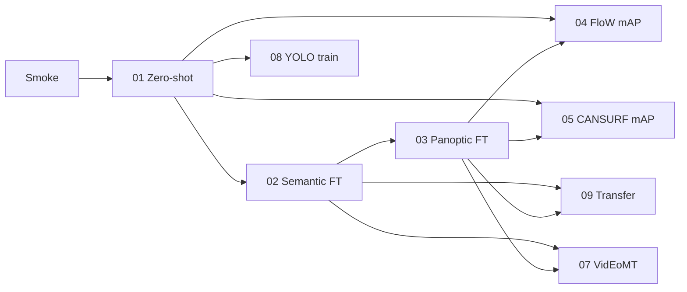

# Water-surface debris segmentation — benchmark report

**Status:** v1 complete except WSODD (excluded). **2026-10-13: all FloW/CANSURF box metrics restated** after the box scorer was replaced with pycocotools ([`RESCORE.md`](RESCORE.md), [decision log](../../docs/water_debris_seg_decision_log.md)). YOLOv11n now trained on FloW (mAP **0.390**). VidEoMT does not beat EoMT temporal proxy.  
**Updated:** 2026-10-13.

Start here for **what we measure, why each ablation exists, and headline numbers**. Full run detail lives in each ablation folder.

---

## Benchmark motivation

**Mission.** Nearshore **USV camera** perception: find **surface debris** (pickup) while not confusing **dynamic obstacles** (boats, buoys, swimmers) or **water/sky** context.

**Research question.** Can general-purpose **mask transformers** (EoMT, VidEoMT) match or beat **specialized detectors** (YOLO) on debris, and does **temporal** modeling help on USV video?

**Why two evaluation protocols.** LaRS has **pixel** panoptic/semantic GT — the only legal place to **train** EoMT/VidEoMT masks. FloW and CANSURF have **boxes only**. Training on rectangle or SAM-filled “masks” would optimize painting the box, not the object. So box datasets are **eval-only** for segmenters: **masks → axis-aligned boxes → COCO mAP / AP_S**. YOLO may **train** on box datasets (native GT).

**Operational taxonomy** (unified classes across datasets):

| Unified class | Meaning | Dataset hooks |
|---|---|---|
| **debris** | Waste, cans, floats | FloW waste, CANSURF `can`, LaRS Float/Other |
| **dynamic_obstacle** | Boats, buoys, swimmers, animals | LaRS panoptic things |
| **static_context** | Shore, static structure | LaRS static obstacle (semantic) |
| **water / sky** | Stuff regions | LaRS semantic IDs 1, 2 |

---

## Hard rule

Train EoMT/VidEoMT masks **only on LaRS**. On **FloW** and **CANSURF**: **eval only** via mask→box mAP. **YOLO** may train on box datasets.

| | LaRS | FloW / CANSURF |
|---|---|---|
| EoMT / VidEoMT **train** | Yes (LaRS masks) | **No** |
| EoMT / VidEoMT **eval** | PQ, mIoU, temporal | mask→box **mAP**, **AP_S** |
| YOLO **train + eval** | Optional | Yes |

[Ablation 06](ablations/06_wsodd_distractors/README.md) (WSODD) is **out of scope v1** — Baidu hosting; see [decision log](../../docs/water_debris_seg_decision_log.md).

---

## Metrics (what the numbers mean)

### LaRS — segmentation (native GT)

| Metric | Where used | Definition (headline) |
|---|---|---|
| **mIoU** | Semantic (ablation 02) | Mean IoU over LaRS PNG classes: obstacle (0), water (1), sky (2); ignore 255. Pixel-level, no instance matching. |
| **PQ** | Panoptic (01 zero-shot bridge, 03 FT) | **Panoptic Quality** = SQ × RQ after matching pred/GT segments at **IoU > 0.5** (Kirillov et al., CVPR 2019). |
| **SQ** | Panoptic | Mean IoU of **matched** pairs only (segmentation quality). |
| **RQ** | Panoptic | Recognition F1 from TP/FP/FN of segment matching. |
| **PQ things / stuff** | Panoptic | Slices for countable instances vs amorphous regions (boats/buoys/floats vs water/sky/obstacle). |

**Reading PQ across ablations.** Since 2026-10-13, [01](ablations/01_zeroshot_lars/README.md) and [03](ablations/03_finetune_lars_panoptic/README.md) are both scored in **native LaRS 11-class** space: 01 maps the frozen COCO head's *predictions* into LaRS classes ([`coco133_to_lars_pred_map.json`](../../water-debris-seg/configs/coco133_to_lars_pred_map.json)); the same script reproduces 03's EoMT validate PQ (0.3946 vs 0.3945). The earlier 01 value (0.0014) used a GT bridge with wrong COCO ids and is superseded. Three LaRS thing classes (row boats, buoy, float) have no COCO counterpart and are 0 for zero-shot by construction.

### LaRS — video (ablation 07)

| Metric | Meaning |
|---|---|
| **Flicker** | 1 − mean consecutive-frame **semantic** mIoU on `images_seq` clips tied to val keyframes (lower = more stable). |
| **VIS AP / thing ID stability** | VidEoMT video instance metrics on LaRS YTVIS export (when config is valid). |
| **FPS** | Optional via upstream `benchmark.py`. |

### FloW / CANSURF — detection bridge (eval only)

1. Frozen or LaRS-trained checkpoint → panoptic/semantic **masks**.
2. Drop **stuff**; keep **thing**-like regions (or semantic obstacle CCs in ablation 09).
3. **Mask → box** (min/max foreground pixels).
4. Map to dataset class (`waste`, `can`, or obstacle proxy).
5. Score vs native boxes:

| Metric | Meaning |
|---|---|
| **mAP** | COCO AP@[.50:.95] via **pycocotools** (`eval_coco_bbox.py`, since 2026-10-13). Every GT image counts, including images a method left empty. |
| **AP50 / AP75** | AP at single IoU thresholds. |
| **AP_S / AP_small** | AP@[.50:.95] on GT boxes with area **&lt; 32²**. Meaningful on **FloW** (1,199 of 2,024 boxes small); **not reported for CANSURF** (19 of 11,526). |
| **AR100** | Recall at 100 detections/image. Fairer than AP for EoMT, whose mask→box outputs all carry a fixed score of 0.5. |

**Scorer change (2026-10-13).** Numbers before this date came from a hand-rolled scorer (now `eval_coco_bbox_legacy.py`) that averaged only AP@.50/.75, ignored false positives in AP_small and skipped images without predictions. All headline box numbers below are re-scored from the saved prediction files; old values are kept as `*.metrics.legacy.json` and in [`RESCORE.md`](RESCORE.md).

EoMT boxes use a fixed score **0.5**, so AP cannot rank their hits above their misses; read **AR100** alongside mAP. Optional `box_proxy_IoU` vs GT rectangles is diagnostic only, not a headline metric.

### YOLO (ablation 08)

Native box training and val: **mAP50-95**, mAP50, precision/recall on CANSURF/FloW splits.

---

## Datasets and models (shared context)

| Dataset | Labels | Role in benchmark |
|---|---|---|
| **LaRS** | Panoptic + semantic masks; 9-frame sequences | **Only mask-training** set; PQ/mIoU + VidEoMT |
| **FloW-Img** | Boxes (`waste`); many small objects | Inland waste; mask→box mAP (ORCA download) |
| **CANSURF** | 1-class YOLO (`can`) | Reflective far-field cans; mask→box vs YOLO |
| **WSODD** | 14-class boxes | *Out of scope v1* (ablation 06) |

| Model | Role |
|---|---|
| **EoMT** | Image panoptic/semantic VFM ([CVPR 2025](https://arxiv.org/pdf/2503.19108)) |
| **VidEoMT** | Online video segmentation ([CVPR 2026](https://arxiv.org/abs/2602.17807)) |
| **YOLOv11** | In-domain detection ceiling on box datasets |

**Eval ladder:** smoke → **01 zero-shot** → **02/03 LaRS FT** → **04/05/09 box eval** → **08 YOLO** → **07 temporal**.

---

## Headline results

| Method | LaRS PQ / mIoU | FloW mAP (AP_small · AR100) | CANSURF mAP (AR100) | Source |
|---|---|---|---|---|
| EoMT zero-shot (COCO-133) | PQ **0.298** (things 0.073, stuff 0.899) | **0.034** (0.012 · 0.093) | **0.095** (0.140) | [01](ablations/01_zeroshot_lars/README.md), [04](ablations/04_flow_mask2box/README.md), [05](ablations/05_cansurf_small_object/README.md) |
| EoMT LaRS semantic FT | mIoU **98.0** | **0.082** (0.044 · 0.281) | **0.063**; min256 **0.078** (0.173) | [02](ablations/02_finetune_lars_semantic/README.md), [09](ablations/09_cross_dataset_transfer/README.md) |
| EoMT LaRS panoptic FT | PQ ≈ **0.395** | **0.014** (0.007 · 0.051) | **0.034** (0.047) | [03](ablations/03_finetune_lars_panoptic/README.md), [04](ablations/04_flow_mask2box/README.md), [05](ablations/05_cansurf_small_object/README.md) |
| YOLOv11n (in-domain) | — | **0.390** (0.249 · 0.491) | **0.857** (0.870) | [08](ablations/08_specialized_yolo/README.md) |
| VidEoMT LaRS | EoMT flicker **0.041** / **0.229**; VidEoMT flicker **0.612** (4k) → **0.311** (16k); AP **0.016** (4k) / **0.009** (16k) | — | — | [07](ablations/07_videomt_temporal/README.md) |

All box metrics: pycocotools, re-scored 2026-10-13 ([`RESCORE.md`](RESCORE.md) lists every prediction file with sha256 and legacy vs new values). CANSURF GT = aligned (2209 images).

### Qualitative error analysis

Panels, error taxonomy and findings: [`qualitative/README.md`](qualitative/README.md). Headline: zero-shot / panoptic EoMT mostly **miss** debris (73–86% of GT never detected), while the semantic path **finds but merges** it (65% of CANSURF cans, 24% of FloW bottles fused into multi-object boxes). On LaRS, panoptic FT finds only **14% of small objects**, and LaRS val contains just 3 "Float" instances.

---

## Experiment catalog (motivation, I/O, relevance)

Each row is one ablation. **Inputs → outputs** describe the scored artifact; **Relevance** is why the benchmark needs it.

### 01 — [Zero-shot EoMT on LaRS + box bridge](ablations/01_zeroshot_lars/README.md)

| | |
|---|---|
| **Question** | Do unfine-tuned COCO EoMT weights transfer to maritime panoptic labels and debris-like **detection** on box sets? |
| **Train?** | **No** — `validate` only; COCO class head kept. |
| **Inputs** | RGB stills; frozen `coco_panoptic_eomt_base_640_2x.bin`; LaRS val panoptic GT **remapped to COCO-133**; box-set images + box GT for mAP only. |
| **Outputs** | Panoptic maps → **PQ/SQ/RQ** (LaRS); thing masks → boxes → **mAP/AP_S** (FloW/CANSURF). |
| **Metrics** | `val_pq_all`, things/stuff PQ; mask→box mAP, AP_small. |
| **Relevance** | **Floor** for the whole ladder. If generic VFMs already worked, LaRS FT (02/03) and YOLO (08) would be unnecessary. Establishes LaRS PQ 0.298 zero-shot (strong on water/sky/boats, weak on small things; FT adds +0.10) and a ~9× mAP gap vs YOLO on CANSURF. |
| **Status** | **Done**; LaRS PQ re-run 2026-10-13 (job 28011322, pred-side remap). |

### 02 — [LaRS semantic fine-tune (3-class)](ablations/02_finetune_lars_semantic/README.md)

| | |
|---|---|
| **Question** | Does LaRS-only FT on **obstacle / water / sky** improve USV scene understanding? |
| **Train?** | **Yes — LaRS train semantic PNGs only**; `load_ckpt_class_head False`; classes 0/1/2. |
| **Inputs** | LaRS train/val semantic masks; init from COCO/ADE EoMT. |
| **Outputs** | Per-pixel 3-class maps → **mIoU**; checkpoint reused for 09 obstacle CC→box on FloW/CANSURF. |
| **Metrics** | `val_iou_all` (mIoU); optional attribute slices (glare, waves). |
| **Relevance** | Tests whether **stuff** (water boundaries, sky) is the easy win vs **instances** (03). Semantic obstacle mask is also a **transfer probe** for box datasets without panoptic thing classes. |
| **Status** | **Done** (mIoU ≈ 98.0 val). |

### 03 — [LaRS panoptic fine-tune (11-class)](ablations/03_finetune_lars_panoptic/README.md)

| | |
|---|---|
| **Question** | Can LaRS panoptic FT separate **debris-like things** (Float, Other) from **boats/buoys/swimmers**? |
| **Train?** | **Yes — LaRS panoptic train only**; native 11 LaRS categories. |
| **Inputs** | `panoptic_annotations.json` + instance PNGs; init from 02 or COCO panoptic. |
| **Outputs** | Panoptic thing+stuff maps → **PQ/SQ/RQ** on LaRS val; Lightning ckpt for 04/05/09 mask→box. |
| **Metrics** | `val_pq_all`, things/stuff; downstream mAP when things are boxed. |
| **Relevance** | **Primary maritime segmentation target** for USV: instance obstacles and floats on water. Defines the LaRS-trained mask quality ceiling before cross-domain detection. |
| **Status** | **Done** (PQ ≈ 0.395). |

### 04 — [FloW mask→box (eval only)](ablations/04_flow_mask2box/README.md)

| | |
|---|---|
| **Question** | As a **detector**, how does EoMT (zero-shot vs LaRS panoptic FT) perform on **inland floating waste**? |
| **Train?** | **No** on FloW — inference + mask→box only. |
| **Inputs** | FloW-Img **test** RGB; COCO or ab03 Lightning ckpt; VOC/COCO box GT. |
| **Outputs** | COCO detection JSON → **mAP**, **AP_small**. |
| **Metrics** | bbox mAP 0.50:0.95; AP on area &lt; 32². |
| **Relevance** | **Domain shift**: maritime LaRS vs inland FloW. Many small boxes → stresses AP_S. Complements CANSURF (material/reflection vs environment). |
| **Status** | **Done** (zero-shot 0.034 mAP; panoptic FT 0.014; pycocotools). |

### 05 — [CANSURF small-object mask→box](ablations/05_cansurf_small_object/README.md)

| | |
|---|---|
| **Question** | Can mask transformers detect **reflective aluminum cans** at distance vs YOLOv11? |
| **Train?** | **No** on CANSURF for EoMT/VidEoMT. |
| **Inputs** | CANSURF val images; zero-shot COCO ckpt or ab03 ckpt; YOLO-aligned COCO GT JSON. |
| **Outputs** | Per-image box predictions + **mAP/AP_small**; comparison table vs [08](ablations/08_specialized_yolo/README.md). |
| **Metrics** | mAP, AP_small; optional far-field bin via box area. |
| **Relevance** | **Specialized debris appearance** (metal, glare) at long range — operational hard case for USV pickup. Quantifies gap to in-domain YOLO (0.095 vs 0.857 mAP). Note: CANSURF has almost no small boxes (19), so it tests material/clutter, not far-field size. |
| **Status** | **Done**. |

### 06 — [WSODD distractors](ablations/06_wsodd_distractors/README.md) *(out of scope)*

| | |
|---|---|
| **Question** | (Planned) Find **rubbish** without FP on boats/buoys in 14-class harbor scenes. |
| **Train?** | Would be eval-only on WSODD; **not run in v1**. |
| **Inputs / outputs** | Would be RGB + rubbish box GT → mask→box **rubbish AP**. |
| **Relevance** | Harbor **distractor** stress test; **replaced in v1** by LaRS thing/stuff separation + FloW/CANSURF transfer. |
| **Status** | **Cancelled** (scope, not failure). |

### 07 — [VidEoMT temporal on LaRS sequences](ablations/07_videomt_temporal/README.md)

| | |
|---|---|
| **Question** | Does **online** VidEoMT beat per-frame EoMT on PQ/mIoU and **temporal stability**? |
| **Train?** | VidEoMT **LaRS sequences only** (YTVIS export); box sets still eval-only on stills. |
| **Inputs** | LaRS `images_seq` + panoptic keyframes; YTVIS JSON; optional ab02/ab03 still baselines. |
| **Outputs** | Video panoptic/semantic preds → **PQ** on keyframes; **flicker** / VIS metrics on clips; FPS. |
| **Metrics** | PQ (keyframes); flicker = 1 − mean consecutive semantic mIoU; VIS AP when valid. |
| **Relevance** | USV feeds are **video** — pickup planners care about stable IDs and less mask flicker, not only single-frame PQ. |
| **Status** | **Complete for v1.** EoMT flicker **0.041** / **0.229**. VidEoMT patched **4k** AP **0.016**, flicker **0.612**; **16k** AP **0.009**, flicker **0.311** (eval **27806956**, flicker **27807251**). 16k improves temporal proxy but not AP vs 4k; neither beats EoMT flicker. |

### 08 — [YOLOv11 specialized baselines](ablations/08_specialized_yolo/README.md)

| | |
|---|---|
| **Question** | What is the **in-domain detection ceiling** on box-native data vs EoMT mask→box? |
| **Train?** | **Yes** on CANSURF (and FloW when available) — boxes are valid GT. |
| **Inputs** | YOLO train/val splits; native box labels. |
| **Outputs** | Detector checkpoints → **mAP50-95**, mAP50, P/R on val/test. |
| **Metrics** | Ultralytics val metrics (same splits as 04/05 for comparison). |
| **Relevance** | **Upper bound** for “train where labels exist.” Every EoMT mask→box number is interpreted against this ceiling on CANSURF. |
| **Status** | **Done.** CANSURF 0.857, FloW 0.390 mAP (pycocotools; Ultralytics 0.861 / 0.391). |

### 09 — [Cross-dataset transfer](ablations/09_cross_dataset_transfer/README.md)

| | |
|---|---|
| **Question** | After **LaRS-only** FT, does maritime knowledge transfer to FloW/CANSURF via mask→box? |
| **Train?** | **No** on box sets — checkpoints from **02** (semantic obstacle CC→box) and **03** (panoptic thing→box) only. |
| **Inputs** | ab02/ab03 ckpts; FloW test + CANSURF val images; native box GT. |
| **Outputs** | Detection JSONs; side-by-side vs **01** zero-shot and **08** YOLO. |
| **Metrics** | mAP, AP_small; optional min-area CC filter (semantic path). |
| **Relevance** | Separates **“generic VFM”** (01) from **“LaRS-adapted VFM”** without violating the hard rule. Shows semantic helps FloW (0.082 vs 0.034 mAP; recall 0.281 vs 0.093) but panoptic FT **hurts** vs zero-shot on both sets; all EoMT variants are 5–9× below YOLO. |
| **Status** | **Done** (CANSURF + FloW semantic). |

---

## Quick reference — ablation dependencies

---

## Protocol references

- Spec: [`docs/water_debris_seg_benchmark.md`](../../../docs/water_debris_seg_benchmark.md)
- Swarm / agents: [`docs/water_debris_seg_swarm.md`](../../../docs/water_debris_seg_swarm.md)
- Disk: [`data/water_debris/DISK_BUDGET.md`](../../../data/water_debris/DISK_BUDGET.md)
- GPU: [GPU_INVENTORY.md](GPU_INVENTORY.md)
- W&B project: `water-debris-seg`

## Caveats

- FloW requires [ORCA portal](https://orca-tech.cn/en/datasets/FloW/Introduction) approval.
- Snellius: keep heavy data on scratch-shared (14-day inactivity purge); home is persistent but 200 GiB — see `DISK_BUDGET.md`.
- EoMT mask→box uses fixed score 0.5 per box; AP is pessimistic for EoMT — read AR100 alongside.
- Optional aligned GT: `cansurf_val_gt_coco_yolo_aligned.json` (12 corrupt val images dropped).
- Box metrics before 2026-10-13 (legacy scorer) are superseded; see [`RESCORE.md`](RESCORE.md).
- Ablation 01 LaRS PQ restated 2026-10-13 (0.0014 → **0.298**) after a GT-bridge bug (boats→"spoon", water→"food-other"); now scored by prediction-side remap in native LaRS space. Box-set zero-shot results were never affected.
- CANSURF AP_small is not meaningful (19 small GT boxes).
- YOLO FloW runs at imgsz 640 on 1280×720 images (CANSURF recipe parity); a 1280 run may raise the ceiling.
