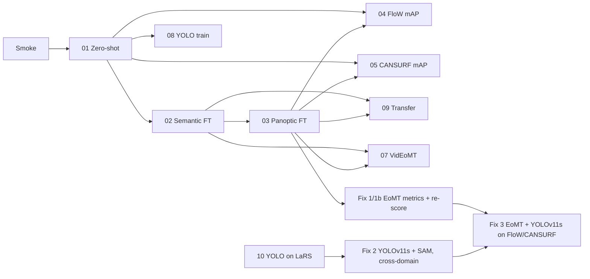

# Water-surface debris segmentation — benchmark report

**Status (2026-10-23): comparison redesigned for fairness; new results pending.** After the last presentation two problems were found: YOLO was trained on FloW / CANSURF while EoMT was only tested there, and three different LaRS metrics shared one column. A third was found while fixing them: EoMT boxes carried a constant confidence (0.5). The agreed fixes, the target table and every decision are in [`fairness_fixes/README.md`](fairness_fixes/README.md); points for Giacomo in [`fairness_fixes/NOTES_FOR_GIACOMO.md`](fairness_fixes/NOTES_FOR_GIACOMO.md). The previous headline table is kept below as superseded.  
**Earlier:** 2026-10-13, all FloW/CANSURF box metrics restated after the box scorer was replaced with pycocotools ([`RESCORE.md`](RESCORE.md), [decision log](../../docs/water_debris_seg_decision_log.md)).  
**Updated:** 2026-10-23.

Start here for **what we measure, why each ablation exists, and headline numbers**. Full run detail lives in each ablation folder.

---

## Benchmark motivation

**Mission.** Nearshore **USV camera** perception: find **surface debris** (pickup) while not confusing **dynamic obstacles** (boats, buoys, swimmers) or **water/sky** context.

**Research question.** Can general-purpose **mask transformers** (EoMT, VidEoMT) match or beat **specialized detectors** (YOLO) on debris, and does **temporal** modeling help on USV video?

**How models are compared (revised 2026-10-23).** Both model families are trained on each dataset they are tested on. LaRS has pixel masks: EoMT trains on them; YOLOv11s trains on boxes traced from them (ablation 10). FloW and CANSURF have boxes only: YOLOv11s trains on the native boxes; EoMT trains on **SAM masks prompted by the ground-truth boxes** (fix 3, after a mask quality check). On box datasets every model is scored as a detector (EoMT: **masks → min/max boxes**). On LaRS, one EoMT model (panoptic) and one YOLO pipeline (YOLOv11s + SAM) each give PQ, mIoU and box AP. The earlier rule (EoMT trained on LaRS only, box datasets eval-only for segmenters) is superseded; see the decision log.

**Operational taxonomy** (unified classes across datasets):

| Unified class | Meaning | Dataset hooks |
|---|---|---|
| **debris** | Waste, cans, floats | FloW waste, CANSURF `can`, LaRS Float/Other |
| **dynamic_obstacle** | Boats, buoys, swimmers, animals | LaRS panoptic things |
| **static_context** | Shore, static structure | LaRS static obstacle (semantic) |
| **water / sky** | Stuff regions | LaRS semantic IDs 1, 2 |

---

## Training and evaluation rule (revised 2026-10-23)

| | LaRS | FloW / CANSURF |
|---|---|---|
| EoMT **train** | Yes (LaRS masks) | Yes, on **box-prompted SAM masks** (fix 3, after the SAM quality check) |
| EoMT **eval** | PQ, mIoU, box AP (masks → min/max boxes) | box AP (masks → min/max boxes); debris-only classes + class-agnostic reference |
| YOLOv11s **train** | Yes (boxes traced from LaRS masks; + Water / Sky for YOLO + SAM) | Yes (native boxes) |
| YOLOv11s **eval** | box AP; PQ, mIoU via YOLOv11s + SAM | box AP; debris-only + class-agnostic reference |
| VidEoMT | LaRS sequences only; per-keyframe mask AP and flicker (separate temporal table) | not evaluated |

Held-out protocol for every training (stage A selects the epoch count on a held-out slice of the training split, stage B retrains on the full split, the test split is scored once). Superseded rule (2026-10-05 to 2026-10-23): EoMT/VidEoMT trained only on LaRS; FloW / CANSURF eval-only for them.

[Ablation 06](ablations/06_wsodd_distractors/README.md) (WSODD) is **out of scope v1** — Baidu hosting; see [decision log](../../docs/water_debris_seg_decision_log.md).

---

## Metrics (what the numbers mean)

### LaRS — segmentation (native GT)

| Metric | Where used | Definition (headline) |
|---|---|---|
| **mIoU** | Semantic (ablation 02) | Mean IoU over LaRS PNG classes: obstacle (0), water (1), sky (2); ignore 255. Pixel-level, no instance matching. |
| **PQ** | Panoptic (01 zero-shot bridge, 03 FT) | **Panoptic Quality** = SQ × RQ after matching pred/GT segments at **IoU > 0.5** (Kirillov et al., CVPR 2019). |
| **SQ** | Panoptic | Mean IoU of **matched** pairs only (segmentation quality). |
| **RQ** | Panoptic | Recognition F1 from TP/FP/FN of segment matching. |
| **PQ things / stuff** | Panoptic | Slices for countable instances vs amorphous regions (boats/buoys/floats vs water/sky/obstacle). |

**Reading PQ across ablations.** Since 2026-10-13, [01](ablations/01_zeroshot_lars/README.md) and [03](ablations/03_finetune_lars_panoptic/README.md) are both scored in **native LaRS 11-class** space: 01 maps the frozen COCO head's *predictions* into LaRS classes ([`coco133_to_lars_pred_map.json`](../../water-debris-seg/configs/coco133_to_lars_pred_map.json)); the same script reproduces 03's EoMT validate PQ (0.3946 vs 0.3945). The earlier 01 value (0.0014) used a GT bridge with wrong COCO ids and is superseded. Three LaRS thing classes (row boats, buoy, float) have no COCO counterpart and are 0 for zero-shot by construction.

### LaRS — video (ablation 07)

| Metric | Meaning |
|---|---|
| **Flicker** | 1 − mean consecutive-frame **semantic** mIoU on `images_seq` clips tied to val keyframes (lower = more stable). |
| **VIS AP / thing ID stability** | VidEoMT video instance metrics on LaRS YTVIS export (when config is valid). |
| **FPS** | Optional via upstream `benchmark.py`. |

### FloW / CANSURF — detection

1. Checkpoint (zero-shot, LaRS-trained cross-domain, or trained on the dataset itself) → **boxes** (YOLO) or panoptic **masks** (EoMT).
2. EoMT: drop region classes; **mask → box** (min/max foreground pixels); score = EoMT's instance confidence (class probability × mean mask probability; since fix 1b, previously a constant 0.5).
3. **Classes counted** (since 2026-10-23): **debris-only** as the main number (LaRS models: Float, Other; COCO zero-shot: bottle, cup, frisbee, sports ball, kite, backpack, handbag, suitcase, umbrella); **class-agnostic** (any predicted object) as reference. Full rule: [`fairness_fixes/COVERAGE_CLASSES.md`](fairness_fixes/COVERAGE_CLASSES.md).
4. Score vs native boxes:

| Metric | Meaning |
|---|---|
| **mAP** | COCO AP@[.50:.95] via **pycocotools** (`eval_coco_bbox.py`, since 2026-10-13). Every GT image counts, including images a method left empty. |
| **AP50 / AP75** | AP at single IoU thresholds. |
| **AP_S / AP_small** | AP@[.50:.95] on GT boxes with area **&lt; 32²**. Meaningful on **FloW** (1,199 of 2,024 boxes small); **not reported for CANSURF** (19 of 11,526). |
| **AR100** | Recall at 100 detections/image. Was the fairer EoMT metric while EoMT boxes carried a fixed score of 0.5 (until fix 1b). |

**Scorer change (2026-10-13).** Numbers before this date came from a hand-rolled scorer (now `eval_coco_bbox_legacy.py`) that averaged only AP@.50/.75, ignored false positives in AP_small and skipped images without predictions. All headline box numbers below are re-scored from the saved prediction files; old values are kept as `*.metrics.legacy.json` and in [`RESCORE.md`](RESCORE.md).

Until fix 1b, EoMT boxes used a fixed score **0.5**, so AP could not rank their hits above their misses; values scored that way are superseded. Optional `box_proxy_IoU` vs GT rectangles is diagnostic only, not a headline metric.

### YOLO (ablations 08, 10)

Box AP with the same pycocotools scorer as EoMT. **YOLOv11s** is the YOLO in the comparison (the CANSURF paper's model); YOLOv11n results (ablations 08, 10) are references. YOLOv11 uses BCE for class scores and CIoU + Distribution Focal Loss for boxes. On LaRS, PQ and mIoU come from **YOLOv11s + SAM** (YOLO's boxes, including Water / Sky, prompt a frozen SAM).

---

## Datasets and models (shared context)

| Dataset | Labels | Role in benchmark |
|---|---|---|
| **LaRS** | Panoptic + semantic masks; 9-frame sequences | Mask training for EoMT, traced boxes for YOLO; PQ / mIoU / box AP + VidEoMT |
| **FloW-Img** | Boxes (`waste`); many small objects | Inland waste; YOLOv11s on native boxes, EoMT on SAM masks; box AP (ORCA download) |
| **CANSURF** | 1-class YOLO (`can`) | Reflective cans; YOLOv11s on native boxes, EoMT on SAM masks; box AP |
| **WSODD** | 14-class boxes | *Out of scope v1* (ablation 06) |

| Model | Role |
|---|---|
| **EoMT** | Image panoptic VFM ([CVPR 2025](https://arxiv.org/pdf/2503.19108)); panoptic in the comparison, semantic (02) as reference |
| **VidEoMT** | Online video segmentation ([CVPR 2026](https://arxiv.org/abs/2602.17807)); separate temporal table |
| **YOLOv11s** | Specialized detector (CANSURF paper's model); YOLOv11n as reference; + SAM for LaRS masks |
| **SAM** (frozen) | Masks from boxes: YOLOv11s + SAM and the EoMT + SAM control on LaRS; pseudo-masks for EoMT training on FloW / CANSURF |

**Eval ladder:** smoke → **01 zero-shot** → **03 LaRS panoptic FT** (02 semantic as reference) → **04/05/09 cross-domain box eval** → **08/10 YOLO** → **fixes 1–3** → **07 temporal** (separate).

---

## Headline results

### Main comparison table (decisions enforced, 2026-10-23)

Every value links to the JSON it comes from (filled 2026-10-26, waves 1–3); each cell names the **classes scored**. Plan and status: [`fairness_fixes/README.md`](fairness_fixes/README.md).

| Model | Trained on | Predicts | LaRS PQ | LaRS mIoU | LaRS box AP (8 obj / 9 cls) | FloW box AP | CANSURF box AP |
|---|---|---|---|---|---|---|---|
| EoMT zero-shot | COCO | COCO-133 | [0.298](fairness_fixes/sources/fix1_coco133_lars_map-tightened_28511590.json) · L11 via map | [93.1](fairness_fixes/sources/fix1_coco133_lars_map-tightened_28511590.json) · L3 | [0.023 / 0.070](fairness_fixes/sources/fix1_coco133_lars_map-tightened_28511590.json) mask → min/max · L8 / L9 via map | [0.071 (0.076)](fairness_fixes/sources/fix1_coco133_flow_map-tightened_28511592.json) mask → min/max · D-COCO | [0.316 (0.305)](fairness_fixes/sources/fix1_coco133_cansurf_map-tightened_28511593.json) mask → min/max · D-COCO |
| **EoMT panoptic** (full fine-tuning) | LaRS | L11 | [**0.405**](fairness_fixes/sources/fix1_lars_panoptic_lars_eomt_full_28511607.json) (ablation 03: [0.395](ablations/03_finetune_lars_panoptic/README.md)) · L11 | [97.1](fairness_fixes/sources/fix1_lars_panoptic_lars_eomt_full_28511607.json) · L3 | [0.134 / 0.171](fairness_fixes/sources/fix1_lars_panoptic_lars_eomt_full_28511607.json) mask → min/max · L8 / L9 | [0.137 (0.092)](fairness_fixes/sources/fix1_lars_panoptic_flow_eomt_full_28547310.json) mask → min/max · D-LaRS *(cross)* | [0.090 (0.097)](fairness_fixes/sources/fix1_lars_panoptic_cansurf_eomt_full_28547312.json) mask → min/max · D-LaRS *(cross)* |
| EoMT panoptic **LoRA** | LaRS | L11 | [0.379](fairness_fixes/sources/fix1_lars_panoptic_lars_eomt_lora_28511609.json) · L11 | [97.2](fairness_fixes/sources/fix1_lars_panoptic_lars_eomt_lora_28511609.json) · L3 | [0.132 / 0.168](fairness_fixes/sources/fix1_lars_panoptic_lars_eomt_lora_28511609.json) mask → min/max · L8 / L9 | [0.049 (0.090)](fairness_fixes/sources/fix1_lars_panoptic_flow_eomt_lora_28547313.json) mask → min/max · D-LaRS *(cross)* | [0.023 (0.161)](fairness_fixes/sources/fix1_lars_panoptic_cansurf_eomt_lora_28547314.json) mask → min/max · D-LaRS *(cross)* |
| EoMT panoptic + SAM (control) | LaRS | L11 | [0.343](fairness_fixes/sources/sam_panoptic_eomt_val_control_28514487.json) → SAM (eval) · L11 | [70.2](fairness_fixes/sources/sam_panoptic_eomt_val_control_28514487.json) → SAM (eval) · L3 | not needed ([same boxes as EoMT panoptic](fairness_fixes/FIX1_LARS_SPLIT_METRICS.md#control-eomt-panoptic--sam-masks-replaced-by-sam)) | not needed | not needed |
| EoMT (SAM masks, full fine-tuning) | FloW | waste | not needed | not needed | not needed | [**0.236**](fairness_fixes/sources/fix1_box_instance_flow_eomt_full_28547302.json) mask → min/max, SAM (train) · waste | not needed |
| EoMT (SAM masks, **LoRA**) | FloW | waste | not needed | not needed | not needed | [0.220](fairness_fixes/sources/fix1_box_instance_flow_eomt_lora_28547305.json) mask → min/max, SAM (train) · waste | not needed |
| EoMT (SAM masks, full fine-tuning) | CANSURF | can | not needed | not needed | not needed | not needed | [**0.631**](fairness_fixes/sources/fix1_box_instance_cansurf_eomt_full_28547307.json) mask → min/max, SAM (train) · can |
| EoMT (SAM masks, **LoRA**) | CANSURF | can | not needed | not needed | not needed | not needed | [0.628](fairness_fixes/sources/fix1_box_instance_cansurf_eomt_lora_28547309.json) mask → min/max, SAM (train) · can |
| **YOLOv11s** | LaRS | L9 | not needed ([→ YOLOv11s + SAM](fairness_fixes/FIX2_YOLO_ON_LARS.md#open-item-a--pq-and-miou-for-yolo-yolo--sam-with-watersky-decided-2026-10-21)) | not needed ([→ YOLOv11s + SAM](fairness_fixes/FIX2_YOLO_ON_LARS.md#open-item-a--pq-and-miou-for-yolo-yolo--sam-with-watersky-decided-2026-10-21)) | [**0.176 / 0.195**](ablations/10_yolo_lars_boxes/README.md) · L8 / L9 | [0.033 (0.073)](fairness_fixes/sources/fix2_yolo11s_lars_on_flow_28511596.json) · D-LaRS *(cross)* | [0.006 (0.023)](fairness_fixes/sources/fix2_yolo11s_lars_on_cansurf_28511597.json) · D-LaRS *(cross)* |
| YOLOv11s + SAM (threshold 0.20) | LaRS | L11 (L9 + Water, Sky) | [0.346](fairness_fixes/sources/sam_panoptic_yolo_val_final_28515871.json) → SAM (eval) · L11 | [68.0](fairness_fixes/sources/sam_panoptic_yolo_val_final_28515871.json) → SAM (eval) · L3 | [0.175 / 0.196](ablations/10_yolo_lars_boxes/sources/eval_lars_full_11s_11cls_stageB_28515717.json) · L8 / L9 | not needed | not needed |
| **YOLOv11s** | FloW | waste | not needed | not needed | not needed | [**0.401**](fairness_fixes/sources/eval_flow_full_11s_stageB_28511601.json) · waste | not needed |
| **YOLOv11s** | CANSURF | can | not needed | not needed | not needed | not needed | [**0.860**](fairness_fixes/sources/eval_cansurf_full_11s_stageB_28511603.json) · can |

FloW / CANSURF in-domain rows: EoMT is trained on SAM masks whose boxes are tighter than the GT boxes; SAM-mask boxes alone score [0.461 / 0.601](fairness_fixes/sources/sam_box_ceiling_ap.json) box AP against GT (AP50 0.97). Compare with AP50 too: CANSURF EoMT 0.967 vs YOLOv11s 0.952, FloW 0.670 vs 0.827 ([table and finding 11](fairness_fixes/RESULTS.md#findings)). Results and findings: [RESULTS.md](fairness_fixes/RESULTS.md).

**Class codes**

| Code | Classes |
|---|---|
| **COCO-133** | 80 COCO objects + 53 COCO regions (full list: [COVERAGE_CLASSES.md § 2](fairness_fixes/COVERAGE_CLASSES.md#2-classes-each-training-source-can-predict-complete-lists)) |
| **L11** | Static Obstacle, Water, Sky, Boat/ship, Row boats, Paddle board, Buoy, Swimmer, Animal, Float, Other |
| **L9** | Static Obstacle + the 8 objects of L8 |
| **L8** | Boat/ship, Row boats, Paddle board, Buoy, Swimmer, Animal, Float, Other |
| **L3** | obstacle (Static Obstacle + L8 merged), water, sky |
| **D-LaRS** (debris) | Float, Other |
| **D-COCO** (debris-like COCO) | bottle, cup, frisbee, sports ball, kite, backpack, handbag, suitcase, umbrella |
| **waste** / **can** | FloW's single class / CANSURF's single class (GT file name `object`) |
| **via map** | COCO predictions mapped to LaRS with the tightened mapping ([COVERAGE_CLASSES.md § 6](fairness_fixes/COVERAGE_CLASSES.md#6-classes-under-the-agreed-decisions-2026-10-23)) |

⏳ = pending (fix named). not needed = covered by another row, or a cross-domain direction not studied. *(cross)* = tested on a dataset the model was not trained on. **mask → min/max** = predicted boxes are the min/max of predicted masks; **→ SAM (eval)** = masks scored are SAM's; **SAM (train)** = trained on SAM pseudo-masks. Box AP = pycocotools mAP@[.50:.95]; FloW / CANSURF main number debris-only, class-agnostic reported next to it.

### Temporal table (VidEoMT, separate)

VidEoMT needs LaRS video sequences and outputs per-keyframe mask AP and a flicker proxy; it gives no PQ / mIoU / box AP, so it is reported apart.

| Model | Trained on | Predicts | Per-keyframe mask AP (L8) | Flicker (lower = steadier) | Source |
|---|---|---|---|---|---|
| EoMT panoptic, per frame (reference) | LaRS stills | L11 | — | 0.229 (all classes) | [07](ablations/07_videomt_temporal/README.md) |
| VidEoMT, 4k iterations | LaRS sequences | L8 | 0.016 | 0.612 (8 object classes) | [07](ablations/07_videomt_temporal/README.md) |
| VidEoMT, 16k iterations | LaRS sequences | L8 | 0.009 | 0.311 (8 object classes) | [07](ablations/07_videomt_temporal/README.md) |

EoMT panoptic's flicker averages over all its classes, VidEoMT's over the 8 object classes; an aligned re-computation is pending. EoMT semantic flicker (0.041) stays in ablation 07 as a reference.

### Superseded headline table (before 2026-10-23, kept for audit)

Not comparable across rows: one column mixes three LaRS metrics, EoMT FloW / CANSURF boxes carried a constant confidence and counted every predicted class as debris, and YOLO (v11n) was trained on FloW / CANSURF while EoMT was not.

| Method | LaRS PQ / mIoU | FloW mAP (AP_small · AR100) | CANSURF mAP (AR100) | Source |
|---|---|---|---|---|
| EoMT zero-shot (COCO-133) | PQ **0.298** (things 0.073, stuff 0.899) | **0.034** (0.012 · 0.093) | **0.095** (0.140) | [01](ablations/01_zeroshot_lars/README.md), [04](ablations/04_flow_mask2box/README.md), [05](ablations/05_cansurf_small_object/README.md) |
| EoMT LaRS semantic FT | mIoU **98.0** | **0.082** (0.044 · 0.281) | **0.063**; min256 **0.078** (0.173) | [02](ablations/02_finetune_lars_semantic/README.md), [09](ablations/09_cross_dataset_transfer/README.md) |
| EoMT LaRS panoptic FT | PQ ≈ **0.395** | **0.014** (0.007 · 0.051) | **0.034** (0.047) | [03](ablations/03_finetune_lars_panoptic/README.md), [04](ablations/04_flow_mask2box/README.md), [05](ablations/05_cansurf_small_object/README.md) |
| YOLOv11n (in-domain) | — | **0.390** (0.249 · 0.491) | **0.857** (0.870) | [08](ablations/08_specialized_yolo/README.md) |
| VidEoMT LaRS | EoMT flicker **0.041** / **0.229**; VidEoMT flicker **0.612** (4k) → **0.311** (16k); AP **0.016** (4k) / **0.009** (16k) | — | — | [07](ablations/07_videomt_temporal/README.md) |

All box metrics in this superseded table: pycocotools, re-scored 2026-10-13 ([`RESCORE.md`](RESCORE.md)). CANSURF GT = aligned (2209 images).

### Qualitative error analysis

Panels, error taxonomy and findings: [`qualitative/README.md`](qualitative/README.md). Headline: zero-shot / panoptic EoMT mostly **miss** debris (73–86% of GT never detected), while the semantic path **finds but merges** it (65% of CANSURF cans, 24% of FloW bottles fused into multi-object boxes). On LaRS, panoptic FT finds only **14% of small objects**, and LaRS val contains just 3 "Float" instances.

---

## Experiment catalog (motivation, I/O, relevance)

Each row is one ablation. **Inputs → outputs** describe the scored artifact; **Relevance** is why the benchmark needs it.

### 01 — [Zero-shot EoMT on LaRS + box bridge](ablations/01_zeroshot_lars/README.md)

| | |
|---|---|
| **Question** | Do unfine-tuned COCO EoMT weights transfer to maritime panoptic labels and debris-like **detection** on box sets? |
| **Train?** | **No** — `validate` only; COCO class head kept. |
| **Inputs** | RGB stills; frozen `coco_panoptic_eomt_base_640_2x.bin`; LaRS val panoptic GT **remapped to COCO-133**; box-set images + box GT for mAP only. |
| **Outputs** | Panoptic maps → **PQ/SQ/RQ** (LaRS); thing masks → boxes → **mAP/AP_S** (FloW/CANSURF). |
| **Metrics** | `val_pq_all`, things/stuff PQ; mask→box mAP, AP_small. |
| **Relevance** | **Floor** for the whole ladder. If generic VFMs already worked, LaRS FT (02/03) and YOLO (08) would be unnecessary. Establishes LaRS PQ 0.298 zero-shot (strong on water/sky/boats, weak on small things; FT adds +0.10) and a ~9× mAP gap vs YOLO on CANSURF. |
| **Role since 2026-10-23** | **Main table: EoMT zero-shot row.** LaRS PQ 0.298 kept (also reported with the tightened COCO → LaRS mapping); mIoU and box AP added by [fix 1](fairness_fixes/FIX1_LARS_SPLIT_METRICS.md); FloW / CANSURF re-scored with real confidences and debris-only classes by fix 1b. |
| **Status** | **Done**; LaRS PQ re-run 2026-10-13 (job 28011322, pred-side remap). |

### 02 — [LaRS semantic fine-tune (3-class)](ablations/02_finetune_lars_semantic/README.md)

| | |
|---|---|
| **Question** | Does LaRS-only FT on **obstacle / water / sky** improve USV scene understanding? |
| **Train?** | **Yes — LaRS train semantic PNGs only**; `load_ckpt_class_head False`; classes 0/1/2. |
| **Inputs** | LaRS train/val semantic masks; init from COCO/ADE EoMT. |
| **Outputs** | Per-pixel 3-class maps → **mIoU**; checkpoint reused for 09 obstacle CC→box on FloW/CANSURF. |
| **Metrics** | `val_iou_all` (mIoU); optional attribute slices (glare, waves). |
| **Relevance** | Tests whether **stuff** (water boundaries, sky) is the easy win vs **instances** (03). Semantic obstacle mask is also a **transfer probe** for box datasets without panoptic thing classes. |
| **Role since 2026-10-23** | **Not in the main table** (decision 2026-10-23): EoMT panoptic covers PQ, mIoU and box AP. Kept as a reference (mIoU 98.0) and used to validate the new mIoU scorer; its FloW / CANSURF values (constant score) are superseded. |
| **Status** | **Done** (mIoU ≈ 98.0 val). |

### 03 — [LaRS panoptic fine-tune (11-class)](ablations/03_finetune_lars_panoptic/README.md)

| | |
|---|---|
| **Question** | Can LaRS panoptic FT separate **debris-like things** (Float, Other) from **boats/buoys/swimmers**? |
| **Train?** | **Yes — LaRS panoptic train only**; native 11 LaRS categories. |
| **Inputs** | `panoptic_annotations.json` + instance PNGs; init from 02 or COCO panoptic. |
| **Outputs** | Panoptic thing+stuff maps → **PQ/SQ/RQ** on LaRS val; Lightning ckpt for 04/05/09 mask→box. |
| **Metrics** | `val_pq_all`, things/stuff; downstream mAP when things are boxed. |
| **Relevance** | **Primary maritime segmentation target** for USV: instance obstacles and floats on water. Defines the LaRS-trained mask quality ceiling before cross-domain detection. |
| **Role since 2026-10-23** | **Main table: the EoMT row** (LaRS PQ 0.395; rerun with the held-out protocol and compared with a LoRA arm in [fix 4](fairness_fixes/FIX4_EOMT_LORA.md); this run's attention-mask annealing never started, so masked attention stayed on at inference). [Fix 1](fairness_fixes/FIX1_LARS_SPLIT_METRICS.md) adds mIoU, box AP and the EoMT + SAM control; fix 1b re-scores its cross-domain FloW / CANSURF boxes. |
| **Status** | **Done** (PQ ≈ 0.395). |

### 04 — [FloW mask→box (eval only)](ablations/04_flow_mask2box/README.md)

| | |
|---|---|
| **Question** | As a **detector**, how does EoMT (zero-shot vs LaRS panoptic FT) perform on **inland floating waste**? |
| **Train?** | **No** on FloW — inference + mask→box only. |
| **Inputs** | FloW-Img **test** RGB; COCO or ab03 Lightning ckpt; VOC/COCO box GT. |
| **Outputs** | COCO detection JSON → **mAP**, **AP_small**. |
| **Metrics** | bbox mAP 0.50:0.95; AP on area &lt; 32². |
| **Relevance** | **Domain shift**: maritime LaRS vs inland FloW. Many small boxes → stresses AP_S. Complements CANSURF (material/reflection vs environment). |
| **Role since 2026-10-23** | **Values superseded** (constant 0.5 score; every predicted class counted as waste). Cross-domain cells are re-scored by fix 1b; EoMT trained on FloW (SAM masks) comes from [fix 3](fairness_fixes/FIX3_SAM_BOX_DATASETS.md). |
| **Status** | **Done** (zero-shot 0.034 mAP; panoptic FT 0.014; pycocotools). |

### 05 — [CANSURF small-object mask→box](ablations/05_cansurf_small_object/README.md)

| | |
|---|---|
| **Question** | Can mask transformers detect **reflective aluminum cans** at distance vs YOLOv11? |
| **Train?** | **No** on CANSURF for EoMT/VidEoMT. |
| **Inputs** | CANSURF val images; zero-shot COCO ckpt or ab03 ckpt; YOLO-aligned COCO GT JSON. |
| **Outputs** | Per-image box predictions + **mAP/AP_small**; comparison table vs [08](ablations/08_specialized_yolo/README.md). |
| **Metrics** | mAP, AP_small; optional far-field bin via box area. |
| **Relevance** | **Specialized debris appearance** (metal, glare) at long range — operational hard case for USV pickup. Quantifies gap to in-domain YOLO (0.095 vs 0.857 mAP). Note: CANSURF has almost no small boxes (19), so it tests material/clutter, not far-field size. |
| **Role since 2026-10-23** | **Values superseded** (constant 0.5 score; every predicted class counted as a can). Cross-domain cells are re-scored by fix 1b; EoMT trained on CANSURF (SAM masks) comes from [fix 3](fairness_fixes/FIX3_SAM_BOX_DATASETS.md). |
| **Status** | **Done**. |

### 06 — [WSODD distractors](ablations/06_wsodd_distractors/README.md) *(out of scope)*

| | |
|---|---|
| **Question** | (Planned) Find **rubbish** without FP on boats/buoys in 14-class harbor scenes. |
| **Train?** | Would be eval-only on WSODD; **not run in v1**. |
| **Inputs / outputs** | Would be RGB + rubbish box GT → mask→box **rubbish AP**. |
| **Relevance** | Harbor **distractor** stress test; **replaced in v1** by LaRS thing/stuff separation + FloW/CANSURF transfer. |
| **Role since 2026-10-23** | Unchanged: out of scope v1. |
| **Status** | **Cancelled** (scope, not failure). |

### 07 — [VidEoMT temporal on LaRS sequences](ablations/07_videomt_temporal/README.md)

| | |
|---|---|
| **Question** | Does **online** VidEoMT beat per-frame EoMT on PQ/mIoU and **temporal stability**? |
| **Train?** | VidEoMT **LaRS sequences only** (YTVIS export); box sets still eval-only on stills. |
| **Inputs** | LaRS `images_seq` + panoptic keyframes; YTVIS JSON; optional ab02/ab03 still baselines. |
| **Outputs** | Video panoptic/semantic preds → **PQ** on keyframes; **flicker** / VIS metrics on clips; FPS. |
| **Metrics** | PQ (keyframes); flicker = 1 − mean consecutive semantic mIoU; VIS AP when valid. |
| **Relevance** | USV feeds are **video** — pickup planners care about stable IDs and less mask flicker, not only single-frame PQ. |
| **Role since 2026-10-23** | **Separate temporal table** (decision 2026-10-23): VidEoMT gives per-keyframe mask AP and flicker, not PQ / mIoU / box AP. |
| **Status** | **Complete for v1.** EoMT flicker **0.041** / **0.229**. VidEoMT patched **4k** AP **0.016**, flicker **0.612**; **16k** AP **0.009**, flicker **0.311** (eval **27806956**, flicker **27807251**). 16k improves temporal proxy but not AP vs 4k; neither beats EoMT flicker. |

### 08 — [YOLOv11 specialized baselines](ablations/08_specialized_yolo/README.md)

| | |
|---|---|
| **Question** | What is the **in-domain detection ceiling** on box-native data vs EoMT mask→box? |
| **Train?** | **Yes** on CANSURF (and FloW when available) — boxes are valid GT. |
| **Inputs** | YOLO train/val splits; native box labels. |
| **Outputs** | Detector checkpoints → **mAP50-95**, mAP50, P/R on val/test. |
| **Metrics** | Ultralytics val metrics (same splits as 04/05 for comparison). |
| **Relevance** | **Upper bound** for “train where labels exist.” Every EoMT mask→box number is interpreted against this ceiling on CANSURF. |
| **Role since 2026-10-23** | **Reference, not in the main table.** These are **YOLOv11n** results with our settings (50 epochs, batch 16), not the CANSURF paper's recipe (YOLOv11s, 150 epochs, batch 64) as previously stated. Replaced in the comparison by YOLOv11s trained with the held-out protocol ([fix 3](fairness_fixes/FIX3_SAM_BOX_DATASETS.md)). |
| **Status** | **Done.** CANSURF 0.857, FloW 0.390 mAP (pycocotools; Ultralytics 0.861 / 0.391). |

### 09 — [Cross-dataset transfer](ablations/09_cross_dataset_transfer/README.md)

| | |
|---|---|
| **Question** | After **LaRS-only** FT, does maritime knowledge transfer to FloW/CANSURF via mask→box? |
| **Train?** | **No** on box sets — checkpoints from **02** (semantic obstacle CC→box) and **03** (panoptic thing→box) only. |
| **Inputs** | ab02/ab03 ckpts; FloW test + CANSURF val images; native box GT. |
| **Outputs** | Detection JSONs; side-by-side vs **01** zero-shot and **08** YOLO. |
| **Metrics** | mAP, AP_small; optional min-area CC filter (semantic path). |
| **Relevance** | Separates **“generic VFM”** (01) from **“LaRS-adapted VFM”** without training on the box sets. Shows semantic helps FloW (0.082 vs 0.034 mAP; recall 0.281 vs 0.093) but panoptic FT **hurts** vs zero-shot on both sets; all EoMT variants are 5–9× below YOLO. |
| **Role since 2026-10-23** | **Cross-domain row of the main table** (LaRS → FloW / CANSURF): panoptic re-scored by fix 1b with debris-only classes (Float, Other); semantic path dropped with ablation 02. The YOLO counterpart comes from [fix 2](fairness_fixes/FIX2_YOLO_ON_LARS.md). |
| **Status** | **Done** (CANSURF + FloW semantic). |

### 10 — [YOLO on LaRS boxes traced from masks](ablations/10_yolo_lars_boxes/README.md)

| | |
|---|---|
| **Question** | How does a specialized detector trained on LaRS compare with EoMT on LaRS itself? |
| **Train?** | **Yes — LaRS train**, boxes traced from the instance masks (min/max), 9 classes; held-out protocol (stage A on 90% of train sequences, stage B on all train). |
| **Inputs** | LaRS train/val images; traced boxes (0 mismatches vs LaRS's stored boxes). |
| **Outputs** | Box AP on LaRS val (8 object / 9 classes, per class); LoRA, focal-loss and size follow-ups. |
| **Metrics** | pycocotools mAP, AP50, AP_small, AR100. |
| **Relevance** | First YOLO trained on the same data as EoMT. |
| **Role since 2026-10-23** | **Main table: YOLOv11s row** (0.176 / 0.195). YOLOv11n (0.145 / 0.168), LoRA and focal variants are references; LoRA is discarded for YOLO. YOLOv11s + SAM (PQ, mIoU) and cross-domain scoring come from [fix 2](fairness_fixes/FIX2_YOLO_ON_LARS.md). |
| **Status** | **Done** (box AP); fix 2 pending. |

---

## Quick reference — ablation dependencies

---

## Protocol references

- Spec: [`docs/water_debris_seg_benchmark.md`](../../docs/water_debris_seg_benchmark.md)
- Swarm / agents: [`docs/water_debris_seg_swarm.md`](../../docs/water_debris_seg_swarm.md)
- Disk: [`data/water_debris/DISK_BUDGET.md`](../../data/water_debris/DISK_BUDGET.md)
- GPU: [GPU_INVENTORY.md](GPU_INVENTORY.md)
- W&B: project `water-debris-seg` (+ two path-named YOLO projects). Every result → run link with online-vs-reported comparison: [`WANDB_AUDIT.md`](WANDB_AUDIT.md); all runs: [`wandb_runs.json`](wandb_runs.json). **The original mask→box runs still show the pre-2026-10-13 (legacy-scorer) values** (tagged `superseded-scorer-2026-10-13`); the corrected values, the corrected ablation 01 PQ and the YOLO FloW test result are logged as new runs in W&B group [`audit_2026-10-13`](https://wandb.ai/riccardo-campanella/water-debris-seg/groups/audit_2026-10-13) (19 runs, pinned to a commit that contains the code).

## Caveats

- FloW requires [ORCA portal](https://orca-tech.cn/en/datasets/FloW/Introduction) approval.
- Snellius: keep heavy data on scratch-shared (14-day inactivity purge); home is persistent but 200 GiB — see `DISK_BUDGET.md`.
- EoMT mask→box values before fix 1b use a fixed score 0.5 per box (AP pessimistic for EoMT) and count every predicted class as debris; they are superseded by fix 1b.
- Optional aligned GT: `cansurf_val_gt_coco_yolo_aligned.json` (12 corrupt val images dropped).
- Box metrics before 2026-10-13 (legacy scorer) are superseded; see [`RESCORE.md`](RESCORE.md). The original W&B runs for ablations 04/05/09 still show the legacy values but are tagged superseded and link to the corrected runs ([`WANDB_AUDIT.md`](WANDB_AUDIT.md)).
- Ablation 01 LaRS PQ restated 2026-10-13 (0.0014 → **0.298**) after a GT-bridge bug (boats→"spoon", water→"food-other"); now scored by prediction-side remap in native LaRS space. Box-set zero-shot results were never affected.
- CANSURF AP_small is not meaningful (19 small GT boxes).
- YOLO FloW runs at imgsz 640 on 1280×720 images (CANSURF recipe parity); a 1280 run may raise the ceiling.
- The main comparison table (2026-10-23) is mostly pending: see [`fairness_fixes/README.md`](fairness_fixes/README.md) for the parallel run schedule (~25–30 GPU hours, ~1–1.5 days of compute after implementation).
- EoMT ablation 03 used COCO's attention-mask annealing schedule (start step 14,782) for a 7,812-step run, so masked attention stayed fully on; new EoMT runs (fixes 3, 4) scale the schedule to the run length.
