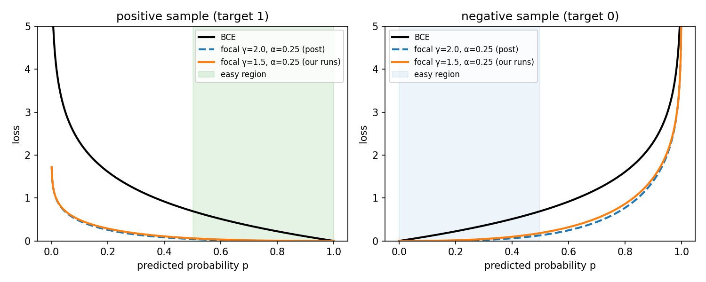
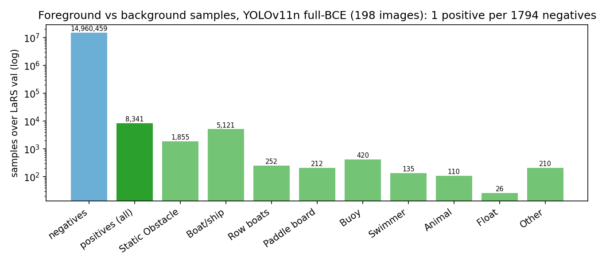
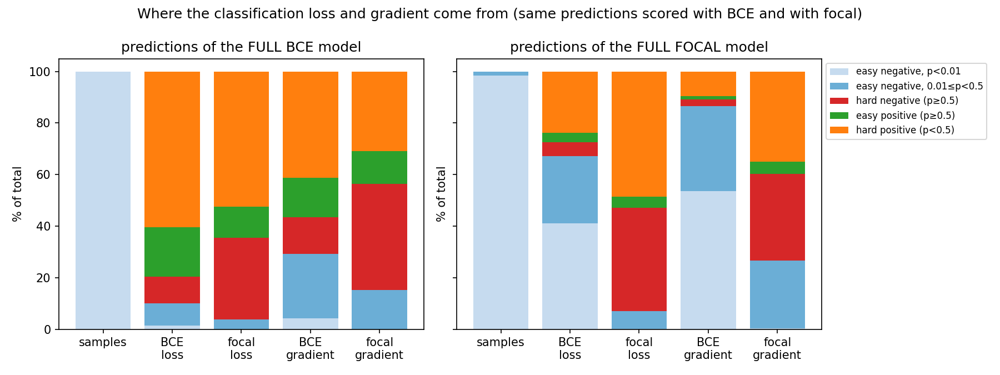
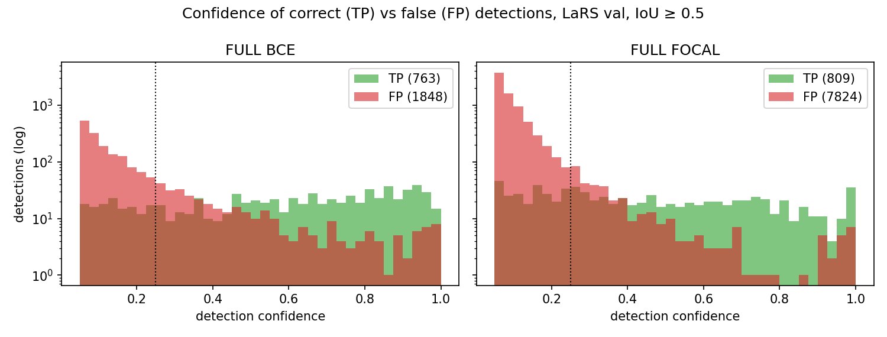
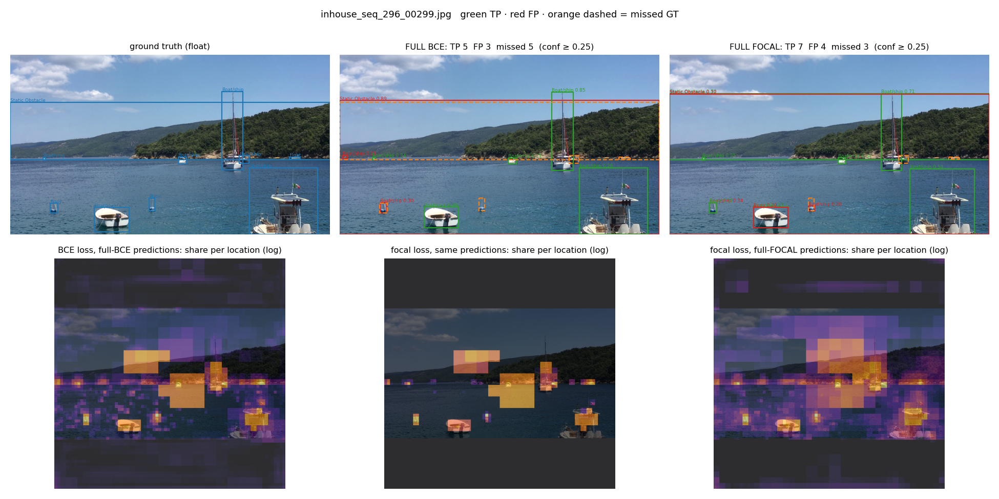
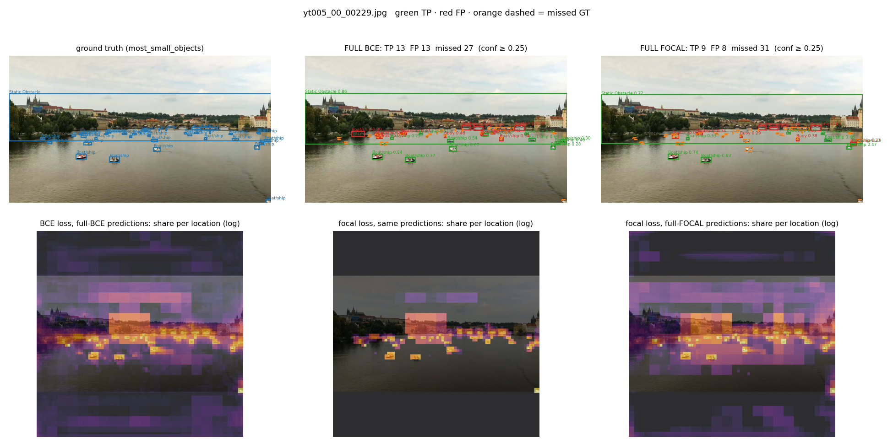

# Focal loss vs BCE on LaRS: why focal loss did not help (qualitative study)

**One-line answer.** The background ≫ foreground imbalance the focal-loss argument rests on is real on LaRS (1 object sample per ~1,800 background samples), but YOLOv11 already neutralises its "easy negatives" without focal loss. Focal loss with α = 0.25 then moves the learning signal **away from objects and onto object-like background**, so the focal models end up less confident on real objects and miss more of them.

| Item | Value |
|---|---|
| Plan (approved 2026-10-20) | [FOCAL_STUDY_PLAN.md](FOCAL_STUDY_PLAN.md) |
| Script | `water-debris-seg/scripts/focal_vs_bce_study.py` |
| Run | Slurm job 28373337, 2026-10-20, 6 min on one A100; log [`focal_study/run_28373337.log`](focal_study/run_28373337.log) |
| All numbers | [`focal_study/study.json`](focal_study/study.json) (checkpoint and GT SHA-256, every table, image list) |
| Data | LaRS val, 198 images, 640 px, no augmentation; analysis only (nothing trained, tuned or selected on it) |
| Models | stage-B `last.pt` of full BCE, full focal, LoRA BCE, LoRA focal ([README § 10b](README.md#ablation-10b--focal-loss)); plus **training start** (COCO weights + fresh 9-class head), added to the plan to test the post's claim about training |
| Reference | S. Trivedi, *Understanding Focal Loss — A Quick Read* (Medium), after Lin et al., *Focal Loss for Dense Object Detection* (2017) |

**Vocabulary (the post's, adapted to YOLOv11).** YOLOv11 scores 9 classes at each of 8,400 grid locations per image: 75,600 *samples* per image. **Positive** = a location matched to an object, for that object's class (target t > 0); **negative** = everything else (t = 0). **Easy** = correctly classified at p threshold 0.5 (positives p ≥ 0.5, negatives p < 0.5), **hard** = misclassified: a hard positive is a missed object, a hard negative is background that looks like an object. Easy negatives are split into p < 0.01 ("trivial") and 0.01–0.5. Results at threshold 0.25 tell the same story (`study.json`, `loss_tables.*."0.25"`).

---

## 1. How the two losses react: toy numbers (post's claim C3)

Natural log, α = 0.25. γ = 2 is the post's example, γ = 1.5 is what our focal runs used. Ratio = BCE / focal, i.e. how strongly focal loss turns that sample down.

| Sample | p | BCE | Focal γ=2 | Ratio | Focal γ=1.5 | Ratio |
|---|---|---|---|---|---|---|
| Easy positive | 0.9 | 0.105 | 0.00026 | **400×** | 0.00083 | 126× |
| Hard positive (missed object) | 0.1 | 2.303 | 0.466 | **4.9×** | 0.491 | 4.7× |
| Easy negative | 0.1 | 0.105 | 0.00079 | 133× | 0.0025 | 42× |
| Hard negative (false alarm) | 0.9 | 2.303 | 1.399 | **1.6×** | 1.474 | 1.6× |
| Trivial negative | 0.001 | 0.0010 | ≈ 0 | 1.3 million× | ≈ 0 | 42,000× |

Source: `study.json → toy`. Curves: 

The post's point holds: easy samples are turned down hundreds of times more than hard ones. Note the asymmetry it does not mention: **a missed object is turned down 4.9×, a false alarm only 1.6×**, because α = 0.25 weights positives 3× less than negatives.

**Corrections to the post** (same formula, recomputed): its numbers use log base 10; the easy-positive focal value is 0.000114, not 0.000125 (ratio 400, not 360); the hard-positive ratio is 1 / 0.2025 = **4.9, not 40**. Its YOLO snippet lists 5,259 "positive" and 42 "negative" RoIs, which contradicts its own text; the labels appear swapped.

## 2. How imbalanced is LaRS for YOLOv11? (claims C1, C4)

| | Value | Source |
|---|---|---|
| Samples per image | 75,600 | `imbalance.samples_per_image` |
| Positive samples per image | mean 42, median 30 | `imbalance.positives_per_image_*` |
| **Background : foreground** | **1,794 : 1** | `imbalance.neg_to_pos_ratio` |
| Positives, Boat/ship vs Float (foreground–foreground) | 5,121 vs 26 (197 : 1); GT boxes 763 vs 3 | `imbalance.positives_per_class`, `gt_boxes_per_class` |

**C1 confirmed**, and stronger than in the post. **C4 confirmed**: the rare-class imbalance is severe. Focal loss does not target it: α and γ treat every class the same.

## 3. Where does the learning signal go? (claim C2: "easy negatives overwhelm the loss")

Share of total classification loss and gradient by sample type. Gradient = |∂loss/∂logit|, which is what actually drives learning.

### 3a. At the start of training

| Sample type | % samples | % BCE loss | % BCE gradient | % focal loss | % focal gradient |
|---|---|---|---|---|---|
| Trivial negatives (p < 0.01) | 99.94 | 12.2 | **51.9** | 0.0 | 0.0 |
| Hard positives | 0.06 | 87.8 | 48.1 | 100.0 | 100.0 |

Source: `loss_tables.init."0.5"`. At the start every score is p ≈ 0.0001: Ultralytics initialises the class bias to log(5 / 9 / (640/8)²), the "prior" trick from the same RetinaNet paper. So easy negatives do **not** dominate the BCE *loss* (12%), but they do send **half the BCE gradient**. Focal loss removes that half entirely. This is the part of the post's argument that applies to YOLOv11.

### 3b. After training, on the same predictions (full BCE model, scored with both losses)

| Sample type | % samples | % BCE loss | % focal loss | % BCE gradient | % focal gradient | Mean BCE / focal |
|---|---|---|---|---|---|---|
| Trivial negatives | 99.87 | 1.3 | 0.0 | 4.3 | 0.0 | 5,853× |
| Easy negatives 0.01–0.5 | 0.07 | 8.8 | 3.8 | 25.1 | 15.3 | 12× |
| **Hard negatives (false alarms)** | 0.004 | 10.3 | 31.6 | **14.2** | **41.1** | 1.7× |
| Easy positives | 0.02 | 19.0 | 12.1 | 15.1 | 12.7 | 8.3× |
| **Hard positives (missed objects)** | 0.04 | 60.5 | 52.4 | **41.3** | **30.9** | 6.1× |

Source: `loss_tables.full_bce."0.5"`. Figure (left panel): 

- **C2 does not hold after BCE training**: easy negatives carry about 10% of the BCE loss. BCE has already pushed them to near zero.
- **Focal loss re-allocates the gradient**: hard negatives go from 14% to **41%**, positives from 56% to **44%**. It pays most attention to *background that looks like an object* (shoreline, wakes, reflections), not to the objects it misses.

### 3c. What focal training produced (each model's own predictions)

| Count over LaRS val | Full BCE | Full focal | Change |
|---|---|---|---|
| Easy positives (object, p ≥ 0.5) | 2,861 | 1,660 | **−42%** |
| Hard positives (object, p < 0.5) | 5,480 | 6,681 | **+22%** |
| Background with 0.01 ≤ p < 0.5 | 10,271 | 232,574 | **22×** |
| Hard negatives (background, p ≥ 0.5) | 539 | 617 | +14% |

Source: `loss_tables.full_bce` vs `loss_tables.full_focal`, `"0.5"`, field `n`. LoRA shows the same pattern (`lora_bce`, `lora_focal`).

The focal model is **less sure about real objects**, and it **leaves much more background at low-but-nonzero scores**, because focal loss stops caring about a negative once it is "easy enough".

## 4. What it does to the detections

Confidence ≥ 0.25, a detection is correct at IoU ≥ 0.5 with the right class; crowd regions ignored.

| Model | Correct (TP) | False (FP) | Missed (FN) | Precision | Recall | Median confidence of TP / FP |
|---|---|---|---|---|---|---|
| **Full BCE** | **628** | 345 | **640** | 0.645 | **0.495** | **0.62** / 0.11 |
| Full focal | 573 | 351 | 695 | 0.620 | 0.452 | 0.43 / 0.08 |
| LoRA BCE | 577 | 314 | 691 | **0.648** | 0.455 | 0.59 / 0.10 |
| LoRA focal | 552 | 342 | 716 | 0.617 | 0.435 | 0.38 / 0.08 |

Source: `detections.*.total`, `precision`, `recall`, `score_quantiles` (median = middle value).

Per class, full BCE → full focal (TP): Boat/ship 406 → 366, Buoy 33 → 38, Other 11 → 2, Animal 3 → 0, Swimmer 5 → 4, Row boats 16 → 14, Paddle board 15 → 13, Static Obstacle 139 → 136, Float 0 → 0 (`detections.*.per_class`).

Above confidence 0.05, the focal model produces **7,824 false detections vs 1,848** for BCE, and its correct detections are spread toward low scores. Scores are compressed: real objects fall under the 0.25 threshold more often, so recall drops (55 more missed objects for the full model).

## 5. Example images

Fixed selection rule (not hand-picked): every val image with a Float, the 3 images with the most small objects, the 3 with the most objects inside a Static Obstacle box, and 3 random (seed 0). Top row: ground truth | full BCE | full focal (green correct, red false, orange dashed missed). Bottom row: where the loss sits (share per location, log scale): BCE and focal on the BCE model's predictions, then focal on the focal model's predictions.

| Group | Image | Full BCE TP / FP / missed | Full focal TP / FP / missed | Figure |
|---|---|---|---|---|
| Float | inhouse_seq_296_00299 | 5 / 3 / 5 | 7 / 4 / 3 | [png](focal_study/examples/float_inhouse_seq_296_00299.png) |
| Float | inhouse_seq_82_00039 | 2 / 2 / 5 | 1 / 2 / 6 | [png](focal_study/examples/float_inhouse_seq_82_00039.png) |
| Float | inhouse_seq_82_00129 | 1 / 1 / 1 | 1 / 2 / 1 | [png](focal_study/examples/float_inhouse_seq_82_00129.png) |
| Most small objects | yt025_04_00139 | 24 / 1 / 42 | 21 / 4 / 45 | [png](focal_study/examples/most_small_objects_yt025_04_00139.png) |
| Most small objects | yt005_00_00229 | 13 / 13 / 27 | 9 / 8 / 31 | [png](focal_study/examples/most_small_objects_yt005_00_00229.png) |
| Most small objects | yt005_00_00319 | 12 / 17 / 25 | 9 / 7 / 28 | [png](focal_study/examples/most_small_objects_yt005_00_00319.png) |
| Inside Static Obstacle | yt005_00_00039 | 23 / 5 / 15 | 13 / 4 / 25 | [png](focal_study/examples/most_objects_inside_static_obstacle_yt005_00_00039.png) |
| Inside Static Obstacle | yt005_00_00089 | 23 / 6 / 12 | 17 / 5 / 18 | [png](focal_study/examples/most_objects_inside_static_obstacle_yt005_00_00089.png) |
| Inside Static Obstacle | inhouse_seq_318_00053 | 2 / 0 / 17 | 1 / 1 / 18 | [png](focal_study/examples/most_objects_inside_static_obstacle_inhouse_seq_318_00053.png) |
| Random | yt075_02_00069 | 3 / 2 / 10 | 3 / 1 / 10 | [png](focal_study/examples/random_seed0_yt075_02_00069.png) |
| Random | inhouse_seq_260_00029 | 2 / 2 / 14 | 2 / 1 / 14 | [png](focal_study/examples/random_seed0_inhouse_seq_260_00029.png) |
| Random | orca_flow_10_00014 | 1 / 3 / 4 | 2 / 1 / 3 | [png](focal_study/examples/random_seed0_orca_flow_10_00014.png) |

Source: `study.json → selection` (LoRA counts included there). Counting correct detections, focal does better on 2 of 12 images (one Float image, one random), worse on 7, equal on 3. The Float boxes themselves are missed by both models in all three Float images.

Two representative figures:

*Float image. Bottom row: BCE spreads a faint loss over the whole scene; focal on the same predictions keeps only the object and object-like regions. The focal-trained model (right) leaves loss spread over large background areas, because its background scores are not pushed to zero.*

*Many small boats along a shoreline. Focal finds 9 instead of 13 and misses 31 instead of 27.*

## 6. Interpretation

1. **The imbalance is real, but YOLOv11 already handles the easy negatives.** The class-bias prior keeps easy negatives at about 12% of the BCE loss even at the start, and BCE training drives them to about 1–10% of the loss. The "easy negatives overwhelm the loss" scenario that focal loss was designed for (RetinaNet without a prior, anchor-based) is largely absent here. What remains is their share of the early gradient (about half), which focal loss does remove.
2. **α = 0.25 tilts focal loss against objects.** A missed object is down-weighted 4.9×, a false alarm only 1.6× (§ 1). On real predictions, focal moves the gradient onto hard negatives (14% → 41%) and off positives (56% → 44%) (§ 3b).
3. **Result: under-confident objects.** Easy positives −42%, median TP confidence 0.62 → 0.43, recall 0.495 → 0.452, and 22× more background at low-but-nonzero scores (§ 3c, § 4). That matches the lower mAP and AP_small of ablation 10b.
4. **The foreground–foreground imbalance (Float 26 positives vs Boat/ship 5,121) is untouched**, as the post itself implies: α and γ do not know about classes. Per-class weighting (Ultralytics `cls_pw`) or more Float data address that; focal loss does not.

**What would make focal a fairer test** (not run): α = 0.5 or 0.75 so positives are not down-weighted; or a larger classification-loss weight to compensate for focal's smaller loss; or varifocal loss, which is designed for soft targets like YOLO's.

## 7. Caveats

- **Single seed** per model; one training run each.
- **"Hard positive" overlaps with "already right"**: YOLO's targets are soft, and 2,265 of the 5,480 hard positives of the BCE model (41%) are within 0.1 of their own target, i.e. nearly perfect but below 0.5 because the target itself is below 0.5 (`hard_pos_within_0.1_of_target`).
- **Targets depend on each model's predictions** (the assigner uses its scores and boxes), so counts are compared between models, not as absolutes.
- **Float**: 3 val boxes; images shown, no Float statistics are interpretable.
- The training-start row was added to the approved plan; it adds no images and uses the same code path.

## 8. Slide-ready takeaways

- On LaRS, YOLOv11 sees **~1,800 background samples per object sample**; Float has 1 sample for every ~200 Boat/ship samples.
- YOLOv11 already defuses easy background (bias prior + BCE): **easy negatives are ~10% of the loss** after training, not the majority.
- Focal (α 0.25, γ 1.5) **shifts the learning signal onto false-alarm background (14% → 41%) and off objects**.
- The focal model is **less confident on real objects** (median 0.62 → 0.43) and **misses more** (recall 0.50 → 0.45).
- Rare classes need **class-aware** fixes, not focal loss.
