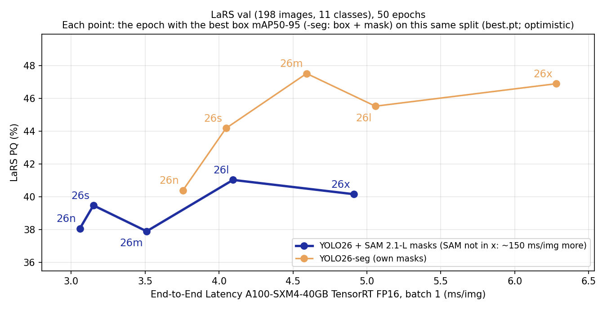
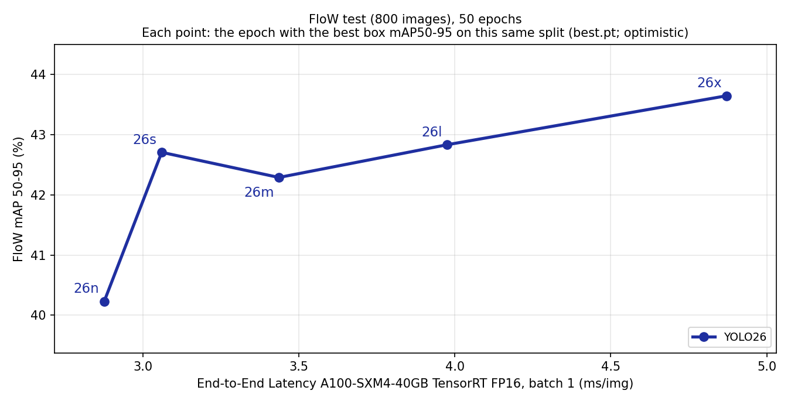
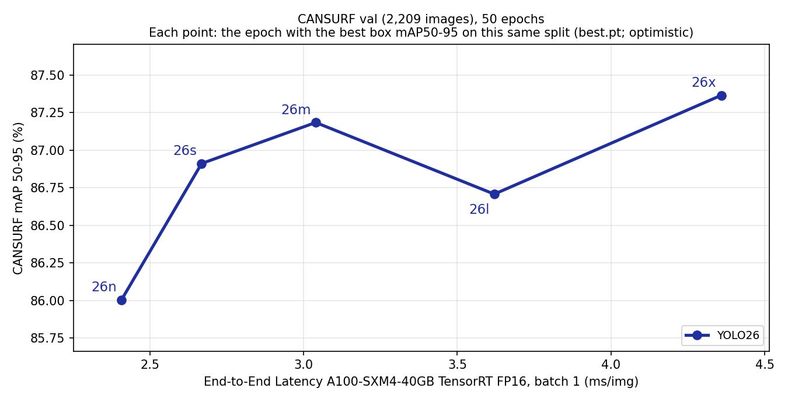

# Ablation 11 — YOLO26 / YOLO26-seg family: accuracy vs end-to-end latency

> **Role in the benchmark (2026-11-02).** Reference study, **not** part of the main comparison table. Every value is the run's `best.pt`: the epoch with the best Ultralytics box (+ mask) mAP50-95 on the same split it is scored on (requested: no held-out protocol; see Checkpoint below), so the accuracies are optimistic and not comparable with the held-out main-table values (YOLOv11s, EoMT).





Plot values with their sources: [`ab11_results.json`](ab11_results.json) (written by `water-debris-seg/scripts/plot_yolo26_family.py`).

## Setup

| | |
|---|---|
| Models | COCO-pretrained `yolo26{n,s,m,l,x}.pt` (detection) and `yolo26{n,s,m,l,x}-seg.pt` (LaRS only: FloW and CANSURF have no mask GT); weights + SHA-256 in `data/water_debris/checkpoints/yolo/` |
| Training | `train_yolo26.py` via `snellius/ablation11_yolo26.sbatch`: 50 epochs, imgsz 640, batch 16, seed 0, Ultralytics 8.4.173 defaults (optimizer auto → AdamW). Train set: LaRS train (all), FloW train, CANSURF train |
| Checkpoint | **Every plotted point and every table value (except the `last.pt` column) is that run's `best.pt`.** Rule (Ultralytics 8.4.173 fitness, unchanged): after each of the 50 epochs the model is scored on the **same split the results are reported on** (LaRS val, FloW test, CANSURF val); `best.pt` is the epoch with the highest box mAP50-95 (detection) or box mAP50-95 + mask mAP50-95 (-seg). Precision, recall and mAP50 have weight 0; no early stopping (patience 50). Only `best.pt` and `last.pt` (epoch 50) are kept. The selection score is **not** the plotted metric (LaRS PQ after the panoptic merge, FloW / CANSURF pycocotools AP50), so `best.pt` need not be the best epoch on the plotted metric: on LaRS `last.pt` is scored as a check and is higher for 6 of 10 models (by 0.02–0.7 PQ), equal for s-seg and lower for n, s and m-seg (by 1.4–2.0) |
| LaRS classes | 11 (`lars11`): Static Obstacle, the 8 LaRS object classes, Water, Sky. Detection labels: `data/water_debris/lars_yolo_11cls`; seg labels from the panoptic masks by `prepare_lars_yolo_seg.py --with-water-sky` (polygon vs mask IoU: [stats](sources/lars11_lars_yolo_seg_label_stats.json)). An earlier 9-class run (`ab11_lars_*`, no Water/Sky, so no full PQ) is kept in `sources/` but not plotted |
| LaRS y | PQ on val at confidence 0.20 (the YOLOv11s + SAM operating point, chosen on held10 in fix 2), `eval_sam_panoptic.py`: detection boxes → SAM 2.1-L masks; -seg: the model's own masks (`--source yolo-seg`, `retina_masks`). Same merge as fix 2. The official LaRS evaluator (lojzezust/lars_evaluator @ 204edd4) is reported next to it; it agrees within 0.6 points |
| FloW / CANSURF y | pycocotools mAP50-95 (IoU 0.50:0.05:0.95; the same metric that picks `best.pt`, decision 2026-11-02) on the main-table GT (FloW test 800 images, `ablations/04_flow_mask2box/sources/flow_test_gt_coco.json`; CANSURF val 2,209 images, `cansurf_val_gt_coco_yolo_aligned.json`). FloW's paper reports COCO-style mmAP (IoU 0.50:0.95) and publishes no eval code, so pycocotools is its protocol. AP50 and CANSURF's paper metric (P / R / F1, its own script) are in the tables |
| x (latency) | Median end-to-end ms/img of the YOLO model alone = Ultralytics `Results.speed` preprocess + inference + postprocess (image decoding excluded), batch 1, imgsz 640, the first 220 test images minus 20 warm-up (200 timed; 178 for LaRS val, which has 198), **TensorRT 10.13 FP16 engine on one A100-SXM4-40GB, all 20 models in one exclusive job** ([`ab11_latency_28836622.json`](sources/ab11_latency_28836622.json), `bench_yolo26_latency.py`, env `envs/trt_latency_venv.txt`). The same job's PyTorch FP16 times are in the tables. For LaRS detection the SAM 2.1-L step (~150 ms/img, FP32) is **not** in x |

## Picked vs scored metric

The epoch is **picked** on one metric (Ultralytics' default `best.pt` rule, not changed or tuned here) and the picked checkpoint is then **scored** on the plotted metric. FloW and CANSURF use the same metric for both (mAP50-95; Ultralytics' implementation for the pick, pycocotools for the plot, e.g. CANSURF 26n 86.7 vs 86.0). LaRS cannot match: PQ is not computable inside Ultralytics training.

| Dataset | Picking the epoch (during training, every epoch) | Y-axis value (scored afterwards on the picked epoch) |
|---|---|---|
| LaRS | Ultralytics box mAP50-95 (-seg: box mAP50-95 + mask mAP50-95) | PQ (our scorer; official LaRS evaluator alongside) |
| FloW | Ultralytics box mAP50-95 | pycocotools box mAP50-95 |
| CANSURF | Ultralytics box mAP50-95 | pycocotools box mAP50-95 |

Why this rule: it is Ultralytics 8.4.173's fitness (`ultralytics/utils/metrics.py`: weights 0 / 0 / 0 / 1 on P / R / mAP50 / mAP50-95; a -seg model's fitness is its box fitness plus its mask fitness, since it predicts both). `train_yolo26.py` keeps that `best.pt`. PQ cannot be computed inside Ultralytics training, so LaRS has no matching option.

**Why the y-axis is mAP50-95 and not AP50 (as first plotted).** With AP50 on the y-axis the pick and the plot disagreed. Picking on AP50 instead was rejected: from each run's per-epoch Ultralytics validation (`curve.per_epoch` in the run JSON), an AP50 pick gains 0–1.4 AP50 but loses 0.4–2.3 mAP50-95 where it changes the epoch (looser boxes), and AP50 moves 1–3 points between the last 15 epochs, so an AP50 pick mostly finds a lucky epoch. Ultralytics' mAP50 is close to, but not the same as, pycocotools AP50 (e.g. FloW 26n 82.9 vs 83.3), so read the gaps as approximate. Only `best.pt` and `last.pt` were kept, so the other epochs cannot be rescored. For LaRS the box mAP50 is over all 11 classes and is not the plotted PQ; it only shows how far the pick is from a box-AP50 pick.

| Run | Plotted metric | Epoch picked (rule above) | Ultralytics box mAP50 at that epoch | Epoch with the highest box mAP50 (value) | -seg: epoch with the highest mask mAP50-95 | Run JSON (`curve.per_epoch`) |
|---|---|---|---|---|---|---|
| FloW 26n | mAP50-95 | 49 | 83.0 | 37 (84.2) | — | [28771673](sources/ab11_flow_yolo26n_28771673.json) |
| FloW 26s | mAP50-95 | 38 | 86.2 | 35 (86.2) | — | [28771677](sources/ab11_flow_yolo26s_28771677.json) |
| FloW 26m | mAP50-95 | 35 | 86.4 | 37 (86.9) | — | [28771682](sources/ab11_flow_yolo26m_28771682.json) |
| FloW 26l | mAP50-95 | 40 | 86.2 | 32 (86.8) | — | [28771686](sources/ab11_flow_yolo26l_28771686.json) |
| FloW 26x | mAP50-95 | 35 | 87.7 | 37 (88.1) | — | [28771690](sources/ab11_flow_yolo26x_28771690.json) |
| CANSURF 26n | mAP50-95 | 38 | 96.9 | 24 (97.3) | — | [28771674](sources/ab11_cansurf_yolo26n_28771674.json) |
| CANSURF 26s | mAP50-95 | 35 | 97.7 | 35 (97.7) | — | [28771679](sources/ab11_cansurf_yolo26s_28771679.json) |
| CANSURF 26m | mAP50-95 | 46 | 97.2 | 33 (97.9) | — | [28771683](sources/ab11_cansurf_yolo26m_28771683.json) |
| CANSURF 26l | mAP50-95 | 45 | 96.2 | 19 (97.6) | — | [28771687](sources/ab11_cansurf_yolo26l_28771687.json) |
| CANSURF 26x | mAP50-95 | 50 | 97.2 | 37 (98.0) | — | [28771691](sources/ab11_cansurf_yolo26x_28771691.json) |
| LaRS 26n | PQ | 39 | 50.1 | 39 (50.1) | — | [28826539](sources/ab11_lars11_yolo26n_28826539.json) |
| LaRS 26s | PQ | 27 | 55.0 | 27 (55.0) | — | [28826550](sources/ab11_lars11_yolo26s_28826550.json) |
| LaRS 26m | PQ | 44 | 55.0 | 39 (55.6) | — | [28826553](sources/ab11_lars11_yolo26m_28826553.json) |
| LaRS 26l | PQ | 45 | 58.1 | 48 (58.6) | — | [28826557](sources/ab11_lars11_yolo26l_28826557.json) |
| LaRS 26x | PQ | 38 | 56.6 | 31 (57.6) | — | [28826560](sources/ab11_lars11_yolo26x_28826560.json) |
| LaRS 26n-seg | PQ | 36 | 47.2 | 42 (48.0) | 44 | [28826541](sources/ab11_lars11_yolo26n-seg_28826541.json) |
| LaRS 26s-seg | PQ | 50 | 50.8 | 33 (52.4) | 46 | [28826552](sources/ab11_lars11_yolo26s-seg_28826552.json) |
| LaRS 26m-seg | PQ | 36 | 55.6 | 36 (55.6) | 36 | [28826555](sources/ab11_lars11_yolo26m-seg_28826555.json) |
| LaRS 26l-seg | PQ | 42 | 54.1 | 47 (54.6) | 44 | [28826559](sources/ab11_lars11_yolo26l-seg_28826559.json) |
| LaRS 26x-seg | PQ | 42 | 56.7 | 45 (56.8) | 48 | [28826562](sources/ab11_lars11_yolo26x-seg_28826562.json) |

Picking on box mAP50 would have raised FloW / CANSURF AP50 by +0.0 to +1.4 (Ultralytics mAP50; largest: CANSURF 26l, 96.2 → 97.6 at epoch 19, with mAP50-95 87.3 → 85.0). For -seg, a mask-only pick would choose a different epoch for 4 of 5 models (same for m-seg). Note: the run JSON field `curve.plotted_metric` / `best_epoch_on_plotted_metric` was written by `train_yolo26.py` before the plotted metrics were fixed; it names Ultralytics mAP50-95 (box, or mask for -seg), **not** what the plots show.

## Results

Every value links to its source JSON; the run JSON holds the training curve, selected epoch, weight SHA-256 and settings. Latency weights are checked against the run JSON's `best.pt` SHA-256 when plotting.

### LaRS val (198 images): PQ at confidence 0.20

| Model | Masks | Params (M) | Epoch picked (of 50) | PQ `best.pt` | things / stuff | PQ `last.pt` | Official LaRS PQ (things / stuff) | TensorRT FP16 ms | PyTorch FP16 ms | Run JSON | W&B |
|---|---|---|---|---|---|---|---|---|---|---|---|
| yolo26n | SAM 2.1-L (+150 ms) | 2.5 | 39 | [38.1](sources/pq_lars11_yolo26n_best_28826539.json) | 29.0 / 62.3 | [36.7](sources/pq_lars11_yolo26n_last_28826539.json) | [38.2](sources/lars_official_ab11_lars11_yolo26n_28826539.json) (29.2 / 62.3) | [3.06](sources/ab11_latency_28836622.json) | 10.44 | [28826539](sources/ab11_lars11_yolo26n_28826539.json) | [lars11_yolo26n_20261102_120019](https://wandb.ai/riccardo-campanella/water-debris-seg/runs/lars11_yolo26n_20261102_120019) |
| yolo26s | SAM 2.1-L (+149 ms) | 10.0 | 27 | [39.5](sources/pq_lars11_yolo26s_best_28826550.json) | 29.1 / 67.3 | [37.8](sources/pq_lars11_yolo26s_last_28826550.json) | [39.8](sources/lars_official_ab11_lars11_yolo26s_28826550.json) (29.6 / 67.3) | [3.15](sources/ab11_latency_28836622.json) | 10.46 | [28826550](sources/ab11_lars11_yolo26s_28826550.json) | [lars11_yolo26s_20261102_120033](https://wandb.ai/riccardo-campanella/water-debris-seg/runs/lars11_yolo26s_20261102_120033) |
| yolo26m | SAM 2.1-L (+152 ms) | 21.8 | 44 | [37.9](sources/pq_lars11_yolo26m_best_28826553.json) | 27.8 / 65.0 | [38.6](sources/pq_lars11_yolo26m_last_28826553.json) | [38.2](sources/lars_official_ab11_lars11_yolo26m_28826553.json) (28.2 / 65.0) | [3.51](sources/ab11_latency_28836622.json) | 11.04 | [28826553](sources/ab11_lars11_yolo26m_28826553.json) | [lars11_yolo26m_20261102_120106](https://wandb.ai/riccardo-campanella/water-debris-seg/runs/lars11_yolo26m_20261102_120106) |
| yolo26l | SAM 2.1-L (+149 ms) | 26.2 | 45 | [41.0](sources/pq_lars11_yolo26l_best_28826557.json) | 31.5 / 66.5 | [41.0](sources/pq_lars11_yolo26l_last_28826557.json) | [41.4](sources/lars_official_ab11_lars11_yolo26l_28826557.json) (32.0 / 66.5) | [4.09](sources/ab11_latency_28836622.json) | 15.32 | [28826557](sources/ab11_lars11_yolo26l_28826557.json) | [lars11_yolo26l_20261102_120102](https://wandb.ai/riccardo-campanella/water-debris-seg/runs/lars11_yolo26l_20261102_120102) |
| yolo26x | SAM 2.1-L (+150 ms) | 58.8 | 38 | [40.2](sources/pq_lars11_yolo26x_best_28826560.json) | 30.5 / 65.8 | [40.3](sources/pq_lars11_yolo26x_last_28826560.json) | [40.8](sources/lars_official_ab11_lars11_yolo26x_28826560.json) (31.5 / 65.8) | [4.91](sources/ab11_latency_28836622.json) | 15.13 | [28826560](sources/ab11_lars11_yolo26x_28826560.json) | [lars11_yolo26x_20261102_120118](https://wandb.ai/riccardo-campanella/water-debris-seg/runs/lars11_yolo26x_20261102_120118) |
| yolo26n-seg | own | 3.1 | 36 | [40.4](sources/pq_lars11_yolo26n-seg_best_28826541.json) | 21.4 / 91.0 | [40.8](sources/pq_lars11_yolo26n-seg_last_28826541.json) | [40.6](sources/lars_official_ab11_lars11_yolo26n-seg_28826541.json) (21.7 / 91.0) | [3.76](sources/ab11_latency_28836622.json) | 12.28 | [28826541](sources/ab11_lars11_yolo26n-seg_28826541.json) | [lars11_yolo26n-seg_20261102_120020](https://wandb.ai/riccardo-campanella/water-debris-seg/runs/lars11_yolo26n-seg_20261102_120020) |
| yolo26s-seg | own | 11.4 | 50 | [44.2](sources/pq_lars11_yolo26s-seg_best_28826552.json) | 26.5 / 91.3 | [44.2](sources/pq_lars11_yolo26s-seg_last_28826552.json) | [44.5](sources/lars_official_ab11_lars11_yolo26s-seg_28826552.json) (27.0 / 91.3) | [4.05](sources/ab11_latency_28836622.json) | 12.31 | [28826552](sources/ab11_lars11_yolo26s-seg_28826552.json) | [lars11_yolo26s-seg_20261102_120040](https://wandb.ai/riccardo-campanella/water-debris-seg/runs/lars11_yolo26s-seg_20261102_120040) |
| yolo26m-seg | own | 27.0 | 36 | [47.5](sources/pq_lars11_yolo26m-seg_best_28826555.json) | 30.8 / 92.0 | [45.5](sources/pq_lars11_yolo26m-seg_last_28826555.json) | [47.7](sources/lars_official_ab11_lars11_yolo26m-seg_28826555.json) (31.2 / 92.0) | [4.59](sources/ab11_latency_28836622.json) | 12.80 | [28826555](sources/ab11_lars11_yolo26m-seg_28826555.json) | [lars11_yolo26m-seg_20261102_120142](https://wandb.ai/riccardo-campanella/water-debris-seg/runs/lars11_yolo26m-seg_20261102_120142) |
| yolo26l-seg | own | 31.4 | 42 | [45.5](sources/pq_lars11_yolo26l-seg_best_28826559.json) | 27.9 / 92.5 | [46.0](sources/pq_lars11_yolo26l-seg_last_28826559.json) | [45.8](sources/lars_official_ab11_lars11_yolo26l-seg_28826559.json) (28.3 / 92.5) | [5.06](sources/ab11_latency_28836622.json) | 16.88 | [28826559](sources/ab11_lars11_yolo26l-seg_28826559.json) | [lars11_yolo26l-seg_20261102_120109](https://wandb.ai/riccardo-campanella/water-debris-seg/runs/lars11_yolo26l-seg_20261102_120109) |
| yolo26x-seg | own | 70.5 | 42 | [46.9](sources/pq_lars11_yolo26x-seg_best_28826562.json) | 29.9 / 92.2 | [47.2](sources/pq_lars11_yolo26x-seg_last_28826562.json) | [47.1](sources/lars_official_ab11_lars11_yolo26x-seg_28826562.json) (30.2 / 92.2) | [6.28](sources/ab11_latency_28836622.json) | 16.96 | [28826562](sources/ab11_lars11_yolo26x-seg_28826562.json) | [lars11_yolo26x-seg_20261102_120117](https://wandb.ai/riccardo-campanella/water-debris-seg/runs/lars11_yolo26x-seg_20261102_120117) |

### FloW test (800 images): pycocotools mAP50-95 (plotted)

| Model | Params (M) | Epoch picked (of 50) | mAP50-95 (plotted) | AP50 | Ultralytics mAP50-95 | TensorRT FP16 ms | PyTorch FP16 ms | Run JSON | W&B |
|---|---|---|---|---|---|---|---|---|---|
| yolo26n | 2.5 | 49 | [40.2](sources/coco_eval_flow_yolo26n_28771673.json) | 83.3 | 40.0 | [2.88](sources/ab11_latency_28836622.json) | 10.10 | [28771673](sources/ab11_flow_yolo26n_28771673.json) | [flow_yolo26n_20261030_123557](https://wandb.ai/riccardo-campanella/water-debris-seg/runs/flow_yolo26n_20261030_123557) |
| yolo26s | 9.9 | 38 | [42.7](sources/coco_eval_flow_yolo26s_28771677.json) | 85.5 | 42.6 | [3.06](sources/ab11_latency_28836622.json) | 10.46 | [28771677](sources/ab11_flow_yolo26s_28771677.json) | [flow_yolo26s_20261030_124059](https://wandb.ai/riccardo-campanella/water-debris-seg/runs/flow_yolo26s_20261030_124059) |
| yolo26m | 21.8 | 35 | [42.3](sources/coco_eval_flow_yolo26m_28771682.json) | 86.0 | 42.3 | [3.44](sources/ab11_latency_28836622.json) | 10.89 | [28771682](sources/ab11_flow_yolo26m_28771682.json) | [flow_yolo26m_20261030_125502](https://wandb.ai/riccardo-campanella/water-debris-seg/runs/flow_yolo26m_20261030_125502) |
| yolo26l | 26.2 | 40 | [42.8](sources/coco_eval_flow_yolo26l_28771686.json) | 85.2 | 42.9 | [3.98](sources/ab11_latency_28836622.json) | 14.78 | [28771686](sources/ab11_flow_yolo26l_28771686.json) | [flow_yolo26l_20261030_125846](https://wandb.ai/riccardo-campanella/water-debris-seg/runs/flow_yolo26l_20261030_125846) |
| yolo26x | 58.8 | 35 | [43.6](sources/coco_eval_flow_yolo26x_28771690.json) | 87.3 | 43.7 | [4.87](sources/ab11_latency_28836622.json) | 14.71 | [28771690](sources/ab11_flow_yolo26x_28771690.json) | [flow_yolo26x_20261030_130434](https://wandb.ai/riccardo-campanella/water-debris-seg/runs/flow_yolo26x_20261030_130434) |

### CANSURF val (2,209 images): pycocotools mAP50-95 (plotted)

| Model | Params (M) | Epoch picked (of 50) | mAP50-95 (plotted) | AP50 | Ultralytics mAP50-95 | TensorRT FP16 ms | PyTorch FP16 ms | CANSURF paper F1 (P / R) | Run JSON | W&B |
|---|---|---|---|---|---|---|---|---|---|---|
| yolo26n | 2.5 | 38 | [86.0](sources/coco_eval_cansurf_yolo26n_28771674.json) | 95.9 | 86.7 | [2.41](sources/ab11_latency_28836622.json) | 9.73 | [0.864](sources/cansurf_paper_ab11_yolo26n_28825414.json) (0.871 / 0.857) | [28771674](sources/ab11_cansurf_yolo26n_28771674.json) | [cansurf_yolo26n_20261030_123957](https://wandb.ai/riccardo-campanella/water-debris-seg/runs/cansurf_yolo26n_20261030_123957) |
| yolo26s | 9.9 | 35 | [86.9](sources/coco_eval_cansurf_yolo26s_28771679.json) | 96.6 | 87.6 | [2.67](sources/ab11_latency_28836622.json) | 9.95 | [0.870](sources/cansurf_paper_ab11_yolo26s_28825414.json) (0.876 / 0.864) | [28771679](sources/ab11_cansurf_yolo26s_28771679.json) | [cansurf_yolo26s_20261030_124222](https://wandb.ai/riccardo-campanella/water-debris-seg/runs/cansurf_yolo26s_20261030_124222) |
| yolo26m | 21.8 | 46 | [87.2](sources/coco_eval_cansurf_yolo26m_28771683.json) | 96.7 | 87.8 | [3.04](sources/ab11_latency_28836622.json) | 10.39 | [0.877](sources/cansurf_paper_ab11_yolo26m_28825414.json) (0.888 / 0.866) | [28771683](sources/ab11_cansurf_yolo26m_28771683.json) | [cansurf_yolo26m_20261030_125553](https://wandb.ai/riccardo-campanella/water-debris-seg/runs/cansurf_yolo26m_20261030_125553) |
| yolo26l | 26.2 | 45 | [86.7](sources/coco_eval_cansurf_yolo26l_28771687.json) | 95.7 | 87.2 | [3.62](sources/ab11_latency_28836622.json) | 14.05 | [0.878](sources/cansurf_paper_ab11_yolo26l_28825414.json) (0.896 / 0.862) | [28771687](sources/ab11_cansurf_yolo26l_28771687.json) | [cansurf_yolo26l_20261030_130229](https://wandb.ai/riccardo-campanella/water-debris-seg/runs/cansurf_yolo26l_20261030_130229) |
| yolo26x | 58.8 | 50 | [87.4](sources/coco_eval_cansurf_yolo26x_28771691.json) | 96.5 | 88.0 | [4.36](sources/ab11_latency_28836622.json) | 14.26 | [0.886](sources/cansurf_paper_ab11_yolo26x_28825414.json) (0.906 / 0.867) | [28771691](sources/ab11_cansurf_yolo26x_28771691.json) | [cansurf_yolo26x_20261030_130435](https://wandb.ai/riccardo-campanella/water-debris-seg/runs/cansurf_yolo26x_20261030_130435) |

## Findings

1. **LaRS: YOLO26-seg beats YOLO26 + SAM at every size** (PQ 40.4–47.5 vs 37.9–41.0) and is ~30× faster end to end once SAM is counted. The gap is stuff (Water / Sky): own masks 91–92.5 vs SAM masks 62–67; things are similar (21–32). SAM is prompted with boxes and does poorly on large amorphous water / sky regions.
2. **Accuracy is flat above s/m.** LaRS-seg peaks at m (47.5; x 46.9), detection at l (41.0). FloW mAP50-95 rises 40.2 → 43.6 (n → x) but s, m, l sit within 0.5 (42.3–42.8); CANSURF is nearly flat (86.0–87.4, dip at l). Differences between neighbouring sizes (1–3 points on LaRS, ≤ 1 on FloW from s to l and on CANSURF) are within what epoch picking on the scored split can move: `best.pt` vs `last.pt` differs by up to 2.0 PQ (m-seg).
3. **CANSURF paper metric** ranks the sizes monotonically (F1 0.864 → 0.886, n → x) although mAP50-95 does not (l below m); the main-table YOLOv11s on the same val split scores F1 [0.867](../../fairness_fixes/sources/cansurf_paper_yolo11s_cansurf_28630998.json) (held-out protocol).
4. **Latency (TensorRT FP16, A100):** 2.4–4.9 ms for detection, 3.8–6.3 ms for -seg; preprocessing and postprocessing are 1.5–2.8 ms of it (inference alone 0.9–3.5 ms). PyTorch FP16 at batch 1 is 10–17 ms and almost flat from n to m (per-call overhead).

## Checks and deviations

- **Official LaRS evaluator vs our PQ:** within 0.6 points for all 10 models (official higher in every case, by 0.1–0.6; consistent with the evaluator ignoring object predictions that lie on Static Obstacle). Our scorer was regression-tested on the fix-2 YOLOv11s + SAM run: PQ 0.34615 / mIoU 0.67961 reproduced exactly ([job 28824852](../../fairness_fixes/sources/sam_panoptic_yolo_val_regress_ab11_28824852.json)).
- **CANSURF paper script vs ours** (`cansurf_paper_check_ab11_*_28825414.json`): our TP/FP/FN differ by at most 10 of ~115k counts (F1 ≤ 4e-5): n −5 TP, s −2, m −10 FP, l 0, x +4 TP. Cause: the paper's script calls `model.to("cuda")` before `predict`, which moves box coordinates by up to 0.015 px on 1,837 images (one extra box for m). Deterministic (rerun identical); our matching gives the paper's counts on identical predictions.
- **Latency:** the training-job PyTorch timings (in each run JSON) came from shared nodes and were not used. TensorRT engines were exported with `half=True`, which Ultralytics 8.4.173 maps to `quantize=16` (FP16; the log's deprecation warning is harmless). An earlier timing job (28833838) was cancelled before writing results.
- **Optimistic selection:** epoch picked on the scored split, see the note at the top. Selected epochs range 27–50 of 50; none is at the start of training.

## Reproduce

```bash
sbatch --export=ALL,DATASET=lars11,MODEL=yolo26m-seg water-debris-seg/scripts/snellius/ablation11_yolo26.sbatch   # per dataset / model
sbatch water-debris-seg/scripts/snellius/ablation11_cansurf_paper.sbatch
sbatch water-debris-seg/scripts/snellius/ablation11_latency.sbatch
python water-debris-seg/scripts/plot_yolo26_family.py
```
