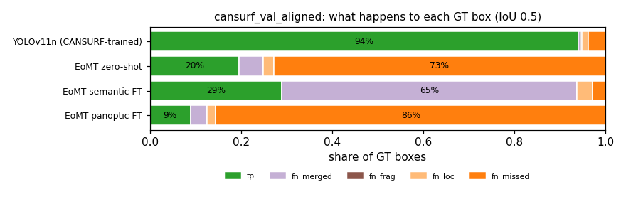
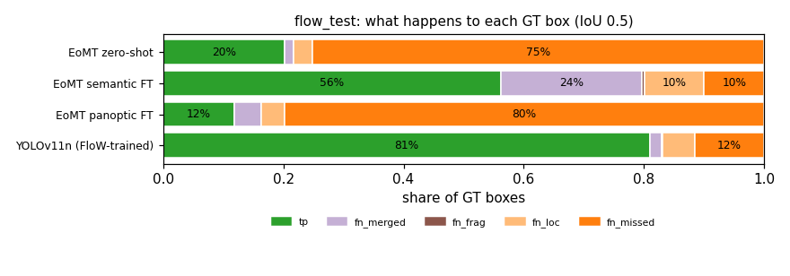

# Qualitative error panels

Generated by `water-debris-seg/scripts/qual_render_panels.py` from [`selection.json`](selection.json) (picked by `qual_error_analysis.py`). Error definitions: `water-debris-seg/water_debris_seg/qualitative/errors.py`; per-box tables: `errors/<run_id>/{detections,gt}.csv`; counts: [`error_summary.csv`](error_summary.csv).

Colours: TP green · FP background red · FP poor localisation pink · FP duplicate magenta · FP merge purple · FN (dashed) missed orange · poorly localised light orange · merged lilac · fragmented brown. Operating point: YOLO score ≥ 0.25; EoMT all boxes (fixed score 0.5).

## cansurf_val_aligned

**Provenance (all panels below):**

- `GT ablations/05_cansurf_small_object/sources/cansurf_val_gt_coco_yolo_aligned.json (da9bd59f7e)`
- `cansurf_yolo11n: ablations/08_specialized_yolo/sources/yolo11n_cansurf_val_preds_coco.json (c6e2fa573e, min_score 0.25)`
- `cansurf_eomt_zeroshot: ablations/05_cansurf_small_object/sources/eomt_zeroshot_val_preds_coco.json (628e8dcd92, min_score 0.0)`
- `cansurf_eomt_semantic_aligned: ablations/09_cross_dataset_transfer/sources/eomt_lars_semantic_cansurf_preds_coco.json (071677d17c, min_score 0.0)`
- `cansurf_eomt_panoptic: ablations/05_cansurf_small_object/sources/eomt_lars_panoptic_ft_val_preds_coco.json (4f3f71b5a8, min_score 0.0)`

| # | Category | Rule | Stats | Image | Panel |
|---|---|---|---|---|---|
| 1 | random | uniform random among images with GT (seed 0) |  | `/scratch-shared/rcampanella/water-debris-seg/data/cansurf/val/images/40_fantasy_jpg.rf.904ff248802c925ed6958f2e4b1d6a8e.jpg` | [01_random_40_fantasy_jpg.rf.904ff248802c925ed6958f.png](panels/cansurf_val_aligned/01_random_40_fantasy_jpg.rf.904ff248802c925ed6958f.png) |
| 2 | random | uniform random among images with GT (seed 0) |  | `/scratch-shared/rcampanella/water-debris-seg/data/cansurf/val/images/frame_0210_mostafa2.jpg` | [02_random_frame_0210_mostafa2.png](panels/cansurf_val_aligned/02_random_frame_0210_mostafa2.png) |
| 3 | random | uniform random among images with GT (seed 0) |  | `/scratch-shared/rcampanella/water-debris-seg/data/cansurf/val/images/frame_2730_zahra_cans.jpg` | [03_random_frame_2730_zahra_cans.png](panels/cansurf_val_aligned/03_random_frame_2730_zahra_cans.png) |
| 4 | random | uniform random among images with GT (seed 0) |  | `/scratch-shared/rcampanella/water-debris-seg/data/cansurf/val/images/frame_6420_zahra_cans.jpg` | [04_random_frame_6420_zahra_cans.png](panels/cansurf_val_aligned/04_random_frame_6420_zahra_cans.png) |
| 5 | random | uniform random among images with GT (seed 0) |  | `/scratch-shared/rcampanella/water-debris-seg/data/cansurf/val/images/sprite-4_4_jpg.rf.4baea2b9335201b58060da83d39ffba2.jpg` | [05_random_sprite-4_4_jpg.rf.4baea2b9335201b58060da.png](panels/cansurf_val_aligned/05_random_sprite-4_4_jpg.rf.4baea2b9335201b58060da.png) |
| 6 | random | uniform random among images with GT (seed 0) |  | `/scratch-shared/rcampanella/water-debris-seg/data/cansurf/val/images/sprite-6_22_jpg.rf.7a4eff617204ec909ab68a08f8edb36f.jpg` | [06_random_sprite-6_22_jpg.rf.7a4eff617204ec909ab68.png](panels/cansurf_val_aligned/06_random_sprite-6_22_jpg.rf.7a4eff617204ec909ab68.png) |
| 7 | merge__cansurf_eomt_zeroshot | most GT boxes merged into one detection (cansurf_eomt_zeroshot) | run=cansurf_eomt_zeroshot, value=11, n_gt=11 | `/scratch-shared/rcampanella/water-debris-seg/data/cansurf/val/images/655_dog_jpg.rf.a53165bf2e4d54e004fabc8fa61dfb59.jpg` | [07_merge_655_dog_jpg.rf.a53165bf2e4d54e004fabc8fa.png](panels/cansurf_val_aligned/07_merge_655_dog_jpg.rf.a53165bf2e4d54e004fabc8fa.png) |
| 8 | merge__cansurf_eomt_zeroshot | most GT boxes merged into one detection (cansurf_eomt_zeroshot) | run=cansurf_eomt_zeroshot, value=10, n_gt=10 | `/scratch-shared/rcampanella/water-debris-seg/data/cansurf/val/images/468_discuss_jpg.rf.47b33c6ba41d9a406d938e12be454c69.jpg` | [08_merge_468_discuss_jpg.rf.47b33c6ba41d9a406d938.png](panels/cansurf_val_aligned/08_merge_468_discuss_jpg.rf.47b33c6ba41d9a406d938.png) |
| 9 | merge__cansurf_eomt_zeroshot | most GT boxes merged into one detection (cansurf_eomt_zeroshot) | run=cansurf_eomt_zeroshot, value=10, n_gt=10 | `/scratch-shared/rcampanella/water-debris-seg/data/cansurf/val/images/575_dog_jpg.rf.f047c37dbe29637182baf044aa0d5aca.jpg` | [09_merge_575_dog_jpg.rf.f047c37dbe29637182baf044a.png](panels/cansurf_val_aligned/09_merge_575_dog_jpg.rf.f047c37dbe29637182baf044a.png) |
| 10 | bkg_fp__cansurf_eomt_zeroshot | most background false positives (cansurf_eomt_zeroshot) | run=cansurf_eomt_zeroshot, value=12, n_gt=1 | `/scratch-shared/rcampanella/water-debris-seg/data/cansurf/val/images/frame_0255_IMG_3620.jpg` | [10_bkg_fp_frame_0255_IMG_3620.png](panels/cansurf_val_aligned/10_bkg_fp_frame_0255_IMG_3620.png) |
| 11 | bkg_fp__cansurf_eomt_zeroshot | most background false positives (cansurf_eomt_zeroshot) | run=cansurf_eomt_zeroshot, value=11, n_gt=1 | `/scratch-shared/rcampanella/water-debris-seg/data/cansurf/val/images/frame_0240_IMG_3620.jpg` | [11_bkg_fp_frame_0240_IMG_3620.png](panels/cansurf_val_aligned/11_bkg_fp_frame_0240_IMG_3620.png) |
| 12 | bkg_fp__cansurf_eomt_zeroshot | most background false positives (cansurf_eomt_zeroshot) | run=cansurf_eomt_zeroshot, value=9, n_gt=2 | `/scratch-shared/rcampanella/water-debris-seg/data/cansurf/val/images/frame_0285_IMG_3620.jpg` | [12_bkg_fp_frame_0285_IMG_3620.png](panels/cansurf_val_aligned/12_bkg_fp_frame_0285_IMG_3620.png) |
| 13 | fragment__cansurf_eomt_zeroshot | most fragmented GT boxes (cansurf_eomt_zeroshot) | run=cansurf_eomt_zeroshot, value=1, n_gt=10 | `/scratch-shared/rcampanella/water-debris-seg/data/cansurf/val/images/485_room_jpg.rf.0e120362815561c585c4916e054f239a.jpg` | [13_fragment_485_room_jpg.rf.0e120362815561c585c4916e.png](panels/cansurf_val_aligned/13_fragment_485_room_jpg.rf.0e120362815561c585c4916e.png) |
| 14 | fragment__cansurf_eomt_zeroshot | most fragmented GT boxes (cansurf_eomt_zeroshot) | run=cansurf_eomt_zeroshot, value=1, n_gt=10 | `/scratch-shared/rcampanella/water-debris-seg/data/cansurf/val/images/485_room_jpg.rf.2e78aac73cd74fdc6da1738cd40d34c1.jpg` | [14_fragment_485_room_jpg.rf.2e78aac73cd74fdc6da1738c.png](panels/cansurf_val_aligned/14_fragment_485_room_jpg.rf.2e78aac73cd74fdc6da1738c.png) |
| 15 | fragment__cansurf_eomt_zeroshot | most fragmented GT boxes (cansurf_eomt_zeroshot) | run=cansurf_eomt_zeroshot, value=1, n_gt=11 | `/scratch-shared/rcampanella/water-debris-seg/data/cansurf/val/images/529_indoor_jpg.rf.1b9d9bc8f4772adc1890f90a45f409d7.jpg` | [15_fragment_529_indoor_jpg.rf.1b9d9bc8f4772adc1890f9.png](panels/cansurf_val_aligned/15_fragment_529_indoor_jpg.rf.1b9d9bc8f4772adc1890f9.png) |
| 16 | merge__cansurf_eomt_semantic_aligned | most GT boxes merged into one detection (cansurf_eomt_semantic_aligned) | run=cansurf_eomt_semantic_aligned, value=13, n_gt=13 | `/scratch-shared/rcampanella/water-debris-seg/data/cansurf/val/images/375_dog_jpg.rf.9ebf22f3ceb195cbbe4493a90712638a.jpg` | [16_merge_375_dog_jpg.rf.9ebf22f3ceb195cbbe4493a90.png](panels/cansurf_val_aligned/16_merge_375_dog_jpg.rf.9ebf22f3ceb195cbbe4493a90.png) |
| 17 | merge__cansurf_eomt_semantic_aligned | most GT boxes merged into one detection (cansurf_eomt_semantic_aligned) | run=cansurf_eomt_semantic_aligned, value=13, n_gt=13 | `/scratch-shared/rcampanella/water-debris-seg/data/cansurf/val/images/375_dog_jpg.rf.a0c4ca4033d84859ee061c3ae672192e.jpg` | [17_merge_375_dog_jpg.rf.a0c4ca4033d84859ee061c3ae.png](panels/cansurf_val_aligned/17_merge_375_dog_jpg.rf.a0c4ca4033d84859ee061c3ae.png) |
| 18 | merge__cansurf_eomt_semantic_aligned | most GT boxes merged into one detection (cansurf_eomt_semantic_aligned) | run=cansurf_eomt_semantic_aligned, value=13, n_gt=13 | `/scratch-shared/rcampanella/water-debris-seg/data/cansurf/val/images/375_dog_jpg.rf.f1c5ff01a86e6871ecdc4ae028ff6ab4.jpg` | [18_merge_375_dog_jpg.rf.f1c5ff01a86e6871ecdc4ae02.png](panels/cansurf_val_aligned/18_merge_375_dog_jpg.rf.f1c5ff01a86e6871ecdc4ae02.png) |
| 19 | bkg_fp__cansurf_eomt_semantic_aligned | most background false positives (cansurf_eomt_semantic_aligned) | run=cansurf_eomt_semantic_aligned, value=99, n_gt=2 | `/scratch-shared/rcampanella/water-debris-seg/data/cansurf/val/images/frame_9705_zahra_cans.jpg` | [19_bkg_fp_frame_9705_zahra_cans.png](panels/cansurf_val_aligned/19_bkg_fp_frame_9705_zahra_cans.png) |
| 20 | bkg_fp__cansurf_eomt_semantic_aligned | most background false positives (cansurf_eomt_semantic_aligned) | run=cansurf_eomt_semantic_aligned, value=98, n_gt=2 | `/scratch-shared/rcampanella/water-debris-seg/data/cansurf/val/images/frame_15765_zahra_cans.jpg` | [20_bkg_fp_frame_15765_zahra_cans.png](panels/cansurf_val_aligned/20_bkg_fp_frame_15765_zahra_cans.png) |
| 21 | bkg_fp__cansurf_eomt_semantic_aligned | most background false positives (cansurf_eomt_semantic_aligned) | run=cansurf_eomt_semantic_aligned, value=82, n_gt=1 | `/scratch-shared/rcampanella/water-debris-seg/data/cansurf/val/images/frame_11820_zahra_cans.jpg` | [21_bkg_fp_frame_11820_zahra_cans.png](panels/cansurf_val_aligned/21_bkg_fp_frame_11820_zahra_cans.png) |
| 22 | fragment__cansurf_eomt_semantic_aligned | most fragmented GT boxes (cansurf_eomt_semantic_aligned) | run=cansurf_eomt_semantic_aligned, value=1, n_gt=1 | `/scratch-shared/rcampanella/water-debris-seg/data/cansurf/val/images/WhatsApp-Image-2022-02-11-at-6-30-11-PM-1-_jpeg_jpg.rf.e1698d09389adbe1ef1d1080a17776af.jpg` | [22_fragment_WhatsApp-Image-2022-02-11-at-6-30-11-PM-.png](panels/cansurf_val_aligned/22_fragment_WhatsApp-Image-2022-02-11-at-6-30-11-PM-.png) |
| 23 | fragment__cansurf_eomt_semantic_aligned | most fragmented GT boxes (cansurf_eomt_semantic_aligned) | run=cansurf_eomt_semantic_aligned, value=1, n_gt=1 | `/scratch-shared/rcampanella/water-debris-seg/data/cansurf/val/images/WhatsApp-Image-2022-02-11-at-6-30-18-PM_jpeg_jpg.rf.85f969879a5f4bb32b74cccf6178e1f0.jpg` | [23_fragment_WhatsApp-Image-2022-02-11-at-6-30-18-PM_.png](panels/cansurf_val_aligned/23_fragment_WhatsApp-Image-2022-02-11-at-6-30-18-PM_.png) |
| 24 | fragment__cansurf_eomt_semantic_aligned | most fragmented GT boxes (cansurf_eomt_semantic_aligned) | run=cansurf_eomt_semantic_aligned, value=1, n_gt=1 | `/scratch-shared/rcampanella/water-debris-seg/data/cansurf/val/images/WhatsApp-Image-2022-02-11-at-6-30-21-PM_jpeg_jpg.rf.528637ca6b35bfc648e7b6c02e80b07f.jpg` | [24_fragment_WhatsApp-Image-2022-02-11-at-6-30-21-PM_.png](panels/cansurf_val_aligned/24_fragment_WhatsApp-Image-2022-02-11-at-6-30-21-PM_.png) |
| 25 | merge__cansurf_eomt_panoptic | most GT boxes merged into one detection (cansurf_eomt_panoptic) | run=cansurf_eomt_panoptic, value=6, n_gt=10 | `/scratch-shared/rcampanella/water-debris-seg/data/cansurf/val/images/387_white_jpg.rf.abeaa42ca055cfe0fa487c32ca3fa90f.jpg` | [25_merge_387_white_jpg.rf.abeaa42ca055cfe0fa487c3.png](panels/cansurf_val_aligned/25_merge_387_white_jpg.rf.abeaa42ca055cfe0fa487c3.png) |
| 26 | merge__cansurf_eomt_panoptic | most GT boxes merged into one detection (cansurf_eomt_panoptic) | run=cansurf_eomt_panoptic, value=6, n_gt=11 | `/scratch-shared/rcampanella/water-debris-seg/data/cansurf/val/images/44_pattern_jpg.rf.86241ef2e12d365aa379931e92d59a15.jpg` | [26_merge_44_pattern_jpg.rf.86241ef2e12d365aa37993.png](panels/cansurf_val_aligned/26_merge_44_pattern_jpg.rf.86241ef2e12d365aa37993.png) |
| 27 | merge__cansurf_eomt_panoptic | most GT boxes merged into one detection (cansurf_eomt_panoptic) | run=cansurf_eomt_panoptic, value=6, n_gt=9 | `/scratch-shared/rcampanella/water-debris-seg/data/cansurf/val/images/63_heart_jpg.rf.1b9b5585d85c467545c7024a6b5be031.jpg` | [27_merge_63_heart_jpg.rf.1b9b5585d85c467545c7024a.png](panels/cansurf_val_aligned/27_merge_63_heart_jpg.rf.1b9b5585d85c467545c7024a.png) |
| 28 | bkg_fp__cansurf_eomt_panoptic | most background false positives (cansurf_eomt_panoptic) | run=cansurf_eomt_panoptic, value=3, n_gt=1 | `/scratch-shared/rcampanella/water-debris-seg/data/cansurf/val/images/frame_13725_zahra_cans.jpg` | [28_bkg_fp_frame_13725_zahra_cans.png](panels/cansurf_val_aligned/28_bkg_fp_frame_13725_zahra_cans.png) |
| 29 | bkg_fp__cansurf_eomt_panoptic | most background false positives (cansurf_eomt_panoptic) | run=cansurf_eomt_panoptic, value=2, n_gt=2 | `/scratch-shared/rcampanella/water-debris-seg/data/cansurf/val/images/IMG_7380.jpg` | [29_bkg_fp_IMG_7380.png](panels/cansurf_val_aligned/29_bkg_fp_IMG_7380.png) |
| 30 | bkg_fp__cansurf_eomt_panoptic | most background false positives (cansurf_eomt_panoptic) | run=cansurf_eomt_panoptic, value=2, n_gt=1 | `/scratch-shared/rcampanella/water-debris-seg/data/cansurf/val/images/IMG_7409.jpg` | [30_bkg_fp_IMG_7409.png](panels/cansurf_val_aligned/30_bkg_fp_IMG_7409.png) |
| 31 | yolo_finds_eomt_misses | largest recall gap: YOLO minus best EoMT (>= 3 GT, gap >= 0.5) | yolo_recall=1.0, gap=1.0 | `/scratch-shared/rcampanella/water-debris-seg/data/cansurf/val/images/345_room_jpg.rf.95f7695043cf54b6b7ea346fade2d980.jpg` | [31_yolo_finds_eomt_misses_345_room_jpg.rf.95f7695043cf54b6b7ea346f.png](panels/cansurf_val_aligned/31_yolo_finds_eomt_misses_345_room_jpg.rf.95f7695043cf54b6b7ea346f.png) |
| 32 | yolo_finds_eomt_misses | largest recall gap: YOLO minus best EoMT (>= 3 GT, gap >= 0.5) | yolo_recall=1.0, gap=1.0 | `/scratch-shared/rcampanella/water-debris-seg/data/cansurf/val/images/355_dog_jpg.rf.75d45e1ed642e6a35f4b383aad225bf4.jpg` | [32_yolo_finds_eomt_misses_355_dog_jpg.rf.75d45e1ed642e6a35f4b383aa.png](panels/cansurf_val_aligned/32_yolo_finds_eomt_misses_355_dog_jpg.rf.75d45e1ed642e6a35f4b383aa.png) |
| 33 | yolo_finds_eomt_misses | largest recall gap: YOLO minus best EoMT (>= 3 GT, gap >= 0.5) | yolo_recall=1.0, gap=1.0 | `/scratch-shared/rcampanella/water-debris-seg/data/cansurf/val/images/35_dog_jpg.rf.23d459ccd9dcca85c5fee16f12e2f7c9.jpg` | [33_yolo_finds_eomt_misses_35_dog_jpg.rf.23d459ccd9dcca85c5fee16f12.png](panels/cansurf_val_aligned/33_yolo_finds_eomt_misses_35_dog_jpg.rf.23d459ccd9dcca85c5fee16f12.png) |
| 34 | yolo_failures | lowest YOLO recall at operating point (>= 2 GT) | yolo_recall=0.0, n_gt=4 | `/scratch-shared/rcampanella/water-debris-seg/data/cansurf/val/images/frame_0000_IMG_3619.jpg` | [34_yolo_failures_frame_0000_IMG_3619.png](panels/cansurf_val_aligned/34_yolo_failures_frame_0000_IMG_3619.png) |
| 35 | yolo_failures | lowest YOLO recall at operating point (>= 2 GT) | yolo_recall=0.0, n_gt=4 | `/scratch-shared/rcampanella/water-debris-seg/data/cansurf/val/images/frame_0060_IMG_3619.jpg` | [35_yolo_failures_frame_0060_IMG_3619.png](panels/cansurf_val_aligned/35_yolo_failures_frame_0060_IMG_3619.png) |
| 36 | yolo_failures | lowest YOLO recall at operating point (>= 2 GT) | yolo_recall=0.0, n_gt=4 | `/scratch-shared/rcampanella/water-debris-seg/data/cansurf/val/images/frame_0075_IMG_3619.jpg` | [36_yolo_failures_frame_0075_IMG_3619.png](panels/cansurf_val_aligned/36_yolo_failures_frame_0075_IMG_3619.png) |

## flow_test

**Provenance (all panels below):**

- `GT ablations/04_flow_mask2box/sources/flow_test_gt_coco.json (29acb22e5a)`
- `flow_eomt_zeroshot: ablations/04_flow_mask2box/sources/eomt_zeroshot_flow_preds_coco.json (cb0b2fb0d2, min_score 0.0)`
- `flow_eomt_semantic: ablations/09_cross_dataset_transfer/sources/eomt_lars_semantic_flow_preds_coco.json (8931009cba, min_score 0.0)`
- `flow_eomt_panoptic: ablations/04_flow_mask2box/sources/eomt_lars_panoptic_flow_preds_coco.json (1d163b9a6e, min_score 0.0)`
- `flow_yolo11n: ablations/08_specialized_yolo/sources/yolo11n_flow_test_preds_coco.json (cdee516f60, min_score 0.25)`

| # | Category | Rule | Stats | Image | Panel |
|---|---|---|---|---|---|
| 1 | random | uniform random among images with GT (seed 0) |  | `/scratch-shared/rcampanella/water-debris-seg/data/flow/test/images/000042.jpg` | [01_random_000042.png](panels/flow_test/01_random_000042.png) |
| 2 | random | uniform random among images with GT (seed 0) |  | `/scratch-shared/rcampanella/water-debris-seg/data/flow/test/images/000266.jpg` | [02_random_000266.png](panels/flow_test/02_random_000266.png) |
| 3 | random | uniform random among images with GT (seed 0) |  | `/scratch-shared/rcampanella/water-debris-seg/data/flow/test/images/000395.jpg` | [03_random_000395.png](panels/flow_test/03_random_000395.png) |
| 4 | random | uniform random among images with GT (seed 0) |  | `/scratch-shared/rcampanella/water-debris-seg/data/flow/test/images/000431.jpg` | [04_random_000431.png](panels/flow_test/04_random_000431.png) |
| 5 | random | uniform random among images with GT (seed 0) |  | `/scratch-shared/rcampanella/water-debris-seg/data/flow/test/images/000524.jpg` | [05_random_000524.png](panels/flow_test/05_random_000524.png) |
| 6 | random | uniform random among images with GT (seed 0) |  | `/scratch-shared/rcampanella/water-debris-seg/data/flow/test/images/000777.jpg` | [06_random_000777.png](panels/flow_test/06_random_000777.png) |
| 7 | merge__flow_eomt_zeroshot | most GT boxes merged into one detection (flow_eomt_zeroshot) | run=flow_eomt_zeroshot, value=7, n_gt=17 | `/scratch-shared/rcampanella/water-debris-seg/data/flow/test/images/000096.jpg` | [07_merge_000096.png](panels/flow_test/07_merge_000096.png) |
| 8 | merge__flow_eomt_zeroshot | most GT boxes merged into one detection (flow_eomt_zeroshot) | run=flow_eomt_zeroshot, value=4, n_gt=13 | `/scratch-shared/rcampanella/water-debris-seg/data/flow/test/images/000546.jpg` | [08_merge_000546.png](panels/flow_test/08_merge_000546.png) |
| 9 | merge__flow_eomt_zeroshot | most GT boxes merged into one detection (flow_eomt_zeroshot) | run=flow_eomt_zeroshot, value=4, n_gt=5 | `/scratch-shared/rcampanella/water-debris-seg/data/flow/test/images/000763.jpg` | [09_merge_000763.png](panels/flow_test/09_merge_000763.png) |
| 10 | missed_small__flow_eomt_zeroshot | most small GT never detected (flow_eomt_zeroshot) | run=flow_eomt_zeroshot, value=13, n_gt=15 | `/scratch-shared/rcampanella/water-debris-seg/data/flow/test/images/000657.jpg` | [10_missed_small_000657.png](panels/flow_test/10_missed_small_000657.png) |
| 11 | missed_small__flow_eomt_zeroshot | most small GT never detected (flow_eomt_zeroshot) | run=flow_eomt_zeroshot, value=11, n_gt=11 | `/scratch-shared/rcampanella/water-debris-seg/data/flow/test/images/000631.jpg` | [11_missed_small_000631.png](panels/flow_test/11_missed_small_000631.png) |
| 12 | missed_small__flow_eomt_zeroshot | most small GT never detected (flow_eomt_zeroshot) | run=flow_eomt_zeroshot, value=9, n_gt=17 | `/scratch-shared/rcampanella/water-debris-seg/data/flow/test/images/000380.jpg` | [12_missed_small_000380.png](panels/flow_test/12_missed_small_000380.png) |
| 13 | bkg_fp__flow_eomt_zeroshot | most background false positives (flow_eomt_zeroshot) | run=flow_eomt_zeroshot, value=12, n_gt=6 | `/scratch-shared/rcampanella/water-debris-seg/data/flow/test/images/000146.jpg` | [13_bkg_fp_000146.png](panels/flow_test/13_bkg_fp_000146.png) |
| 14 | bkg_fp__flow_eomt_zeroshot | most background false positives (flow_eomt_zeroshot) | run=flow_eomt_zeroshot, value=8, n_gt=7 | `/scratch-shared/rcampanella/water-debris-seg/data/flow/test/images/000450.jpg` | [14_bkg_fp_000450.png](panels/flow_test/14_bkg_fp_000450.png) |
| 15 | bkg_fp__flow_eomt_zeroshot | most background false positives (flow_eomt_zeroshot) | run=flow_eomt_zeroshot, value=8, n_gt=1 | `/scratch-shared/rcampanella/water-debris-seg/data/flow/test/images/000500.jpg` | [15_bkg_fp_000500.png](panels/flow_test/15_bkg_fp_000500.png) |
| 16 | merge__flow_eomt_semantic | most GT boxes merged into one detection (flow_eomt_semantic) | run=flow_eomt_semantic, value=12, n_gt=16 | `/scratch-shared/rcampanella/water-debris-seg/data/flow/test/images/000212.jpg` | [16_merge_000212.png](panels/flow_test/16_merge_000212.png) |
| 17 | merge__flow_eomt_semantic | most GT boxes merged into one detection (flow_eomt_semantic) | run=flow_eomt_semantic, value=10, n_gt=10 | `/scratch-shared/rcampanella/water-debris-seg/data/flow/test/images/000469.jpg` | [17_merge_000469.png](panels/flow_test/17_merge_000469.png) |
| 18 | merge__flow_eomt_semantic | most GT boxes merged into one detection (flow_eomt_semantic) | run=flow_eomt_semantic, value=10, n_gt=17 | `/scratch-shared/rcampanella/water-debris-seg/data/flow/test/images/000661.jpg` | [18_merge_000661.png](panels/flow_test/18_merge_000661.png) |
| 19 | missed_small__flow_eomt_semantic | most small GT never detected (flow_eomt_semantic) | run=flow_eomt_semantic, value=3, n_gt=6 | `/scratch-shared/rcampanella/water-debris-seg/data/flow/test/images/000021.jpg` | [19_missed_small_000021.png](panels/flow_test/19_missed_small_000021.png) |
| 20 | missed_small__flow_eomt_semantic | most small GT never detected (flow_eomt_semantic) | run=flow_eomt_semantic, value=3, n_gt=4 | `/scratch-shared/rcampanella/water-debris-seg/data/flow/test/images/000099.jpg` | [20_missed_small_000099.png](panels/flow_test/20_missed_small_000099.png) |
| 21 | missed_small__flow_eomt_semantic | most small GT never detected (flow_eomt_semantic) | run=flow_eomt_semantic, value=3, n_gt=5 | `/scratch-shared/rcampanella/water-debris-seg/data/flow/test/images/000102.jpg` | [21_missed_small_000102.png](panels/flow_test/21_missed_small_000102.png) |
| 22 | bkg_fp__flow_eomt_semantic | most background false positives (flow_eomt_semantic) | run=flow_eomt_semantic, value=10, n_gt=1 | `/scratch-shared/rcampanella/water-debris-seg/data/flow/test/images/000667.jpg` | [22_bkg_fp_000667.png](panels/flow_test/22_bkg_fp_000667.png) |
| 23 | bkg_fp__flow_eomt_semantic | most background false positives (flow_eomt_semantic) | run=flow_eomt_semantic, value=10, n_gt=1 | `/scratch-shared/rcampanella/water-debris-seg/data/flow/test/images/000778.jpg` | [23_bkg_fp_000778.png](panels/flow_test/23_bkg_fp_000778.png) |
| 24 | bkg_fp__flow_eomt_semantic | most background false positives (flow_eomt_semantic) | run=flow_eomt_semantic, value=8, n_gt=2 | `/scratch-shared/rcampanella/water-debris-seg/data/flow/test/images/000036.jpg` | [24_bkg_fp_000036.png](panels/flow_test/24_bkg_fp_000036.png) |
| 25 | fragment__flow_eomt_semantic | most fragmented GT boxes (flow_eomt_semantic) | run=flow_eomt_semantic, value=1, n_gt=3 | `/scratch-shared/rcampanella/water-debris-seg/data/flow/test/images/000127.jpg` | [25_fragment_000127.png](panels/flow_test/25_fragment_000127.png) |
| 26 | fragment__flow_eomt_semantic | most fragmented GT boxes (flow_eomt_semantic) | run=flow_eomt_semantic, value=1, n_gt=4 | `/scratch-shared/rcampanella/water-debris-seg/data/flow/test/images/000154.jpg` | [26_fragment_000154.png](panels/flow_test/26_fragment_000154.png) |
| 27 | fragment__flow_eomt_semantic | most fragmented GT boxes (flow_eomt_semantic) | run=flow_eomt_semantic, value=1, n_gt=3 | `/scratch-shared/rcampanella/water-debris-seg/data/flow/test/images/000204.jpg` | [27_fragment_000204.png](panels/flow_test/27_fragment_000204.png) |
| 28 | merge__flow_eomt_panoptic | most GT boxes merged into one detection (flow_eomt_panoptic) | run=flow_eomt_panoptic, value=3, n_gt=6 | `/scratch-shared/rcampanella/water-debris-seg/data/flow/test/images/000423.jpg` | [28_merge_000423.png](panels/flow_test/28_merge_000423.png) |
| 29 | merge__flow_eomt_panoptic | most GT boxes merged into one detection (flow_eomt_panoptic) | run=flow_eomt_panoptic, value=3, n_gt=6 | `/scratch-shared/rcampanella/water-debris-seg/data/flow/test/images/000665.jpg` | [29_merge_000665.png](panels/flow_test/29_merge_000665.png) |
| 30 | merge__flow_eomt_panoptic | most GT boxes merged into one detection (flow_eomt_panoptic) | run=flow_eomt_panoptic, value=2, n_gt=8 | `/scratch-shared/rcampanella/water-debris-seg/data/flow/test/images/000001.jpg` | [30_merge_000001.png](panels/flow_test/30_merge_000001.png) |
| 31 | missed_small__flow_eomt_panoptic | most small GT never detected (flow_eomt_panoptic) | run=flow_eomt_panoptic, value=11, n_gt=16 | `/scratch-shared/rcampanella/water-debris-seg/data/flow/test/images/000274.jpg` | [31_missed_small_000274.png](panels/flow_test/31_missed_small_000274.png) |
| 32 | missed_small__flow_eomt_panoptic | most small GT never detected (flow_eomt_panoptic) | run=flow_eomt_panoptic, value=10, n_gt=16 | `/scratch-shared/rcampanella/water-debris-seg/data/flow/test/images/000440.jpg` | [32_missed_small_000440.png](panels/flow_test/32_missed_small_000440.png) |
| 33 | missed_small__flow_eomt_panoptic | most small GT never detected (flow_eomt_panoptic) | run=flow_eomt_panoptic, value=9, n_gt=12 | `/scratch-shared/rcampanella/water-debris-seg/data/flow/test/images/000590.jpg` | [33_missed_small_000590.png](panels/flow_test/33_missed_small_000590.png) |
| 34 | bkg_fp__flow_eomt_panoptic | most background false positives (flow_eomt_panoptic) | run=flow_eomt_panoptic, value=5, n_gt=9 | `/scratch-shared/rcampanella/water-debris-seg/data/flow/test/images/000637.jpg` | [34_bkg_fp_000637.png](panels/flow_test/34_bkg_fp_000637.png) |
| 35 | bkg_fp__flow_eomt_panoptic | most background false positives (flow_eomt_panoptic) | run=flow_eomt_panoptic, value=5, n_gt=4 | `/scratch-shared/rcampanella/water-debris-seg/data/flow/test/images/000702.jpg` | [35_bkg_fp_000702.png](panels/flow_test/35_bkg_fp_000702.png) |
| 36 | bkg_fp__flow_eomt_panoptic | most background false positives (flow_eomt_panoptic) | run=flow_eomt_panoptic, value=5, n_gt=1 | `/scratch-shared/rcampanella/water-debris-seg/data/flow/test/images/000741.jpg` | [36_bkg_fp_000741.png](panels/flow_test/36_bkg_fp_000741.png) |
| 37 | yolo_finds_eomt_misses | largest recall gap: YOLO minus best EoMT (>= 3 GT, gap >= 0.5) | yolo_recall=1.0, gap=1.0 | `/scratch-shared/rcampanella/water-debris-seg/data/flow/test/images/000222.jpg` | [37_yolo_finds_eomt_misses_000222.png](panels/flow_test/37_yolo_finds_eomt_misses_000222.png) |
| 38 | yolo_finds_eomt_misses | largest recall gap: YOLO minus best EoMT (>= 3 GT, gap >= 0.5) | yolo_recall=1.0, gap=1.0 | `/scratch-shared/rcampanella/water-debris-seg/data/flow/test/images/000696.jpg` | [38_yolo_finds_eomt_misses_000696.png](panels/flow_test/38_yolo_finds_eomt_misses_000696.png) |
| 39 | yolo_finds_eomt_misses | largest recall gap: YOLO minus best EoMT (>= 3 GT, gap >= 0.5) | yolo_recall=1.0, gap=1.0 | `/scratch-shared/rcampanella/water-debris-seg/data/flow/test/images/000728.jpg` | [39_yolo_finds_eomt_misses_000728.png](panels/flow_test/39_yolo_finds_eomt_misses_000728.png) |
| 40 | yolo_failures | lowest YOLO recall at operating point (>= 2 GT) | yolo_recall=0.0, n_gt=4 | `/scratch-shared/rcampanella/water-debris-seg/data/flow/test/images/000680.jpg` | [40_yolo_failures_000680.png](panels/flow_test/40_yolo_failures_000680.png) |
| 41 | yolo_failures | lowest YOLO recall at operating point (>= 2 GT) | yolo_recall=0.0, n_gt=4 | `/scratch-shared/rcampanella/water-debris-seg/data/flow/test/images/000759.jpg` | [41_yolo_failures_000759.png](panels/flow_test/41_yolo_failures_000759.png) |
| 42 | yolo_failures | lowest YOLO recall at operating point (>= 2 GT) | yolo_recall=0.0, n_gt=3 | `/scratch-shared/rcampanella/water-debris-seg/data/flow/test/images/000165.jpg` | [42_yolo_failures_000165.png](panels/flow_test/42_yolo_failures_000165.png) |

